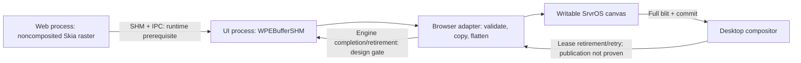

# WebCore dependencies and software-rendering design

November 5, 2026. Status: source/configuration audit and owner design review complete; target
implementation remains unqualified behind the explicit gates below.

## Target and evidence boundary

The proposed next visible target is one bundled HTML/CSS page in a SrvrOS
window, with no-JIT JavaScript changing the DOM after a click, a correct repaint,
and clean shutdown. This document audits the prerequisites and proposes the
backend; it does not implement or qualify that target. No runtime, kernel,
SrvrUI or port implementation changes are part of this audit.

Baseline: OS `88bdc382d50e7387d29ef75d26c03c65fbb16b37`, Ports
`89f22a967415297cc6af9229c2bee950932b4aee`, UI
`3a695ce51e06af0a7ab9c21beedcb8dfe221be9c`, Apps `24bc4541`.
Before publication, actual main advanced to `379d6f8d` through PR378. Its three
changes are Air6,1 documentation only; no inspected runtime, UI or port source
changed. That main update is reconciled into the audit branch.
The prior [JSC checkpoint](browser-port.md) remains an experimental single-CPU
acceptance. It does not qualify a WPE build, production signals, SMP or engine
memory consumption. The workspace reset removed the generated SDK and builds;
their portable historical evidence remains in Git.

The source is the existing pinned
[WPEWebKit 2.54.2 archive](https://wpewebkit.org/releases/wpewebkit-2.54.2.tar.xz),
49,565,492 bytes, SHA256
`f3284e19e47fcb5ac8c63c2e1c113dbd65b2423eb8a545f5b345707829004f56`.
The hash was verified before source inspection. File paths and line numbers
below refer to that archive, not moving upstream main. Selected source text was
extracted under ignored `build/browser-webcore-audit/source`; it is not a full
build tree. The [audit receipt](assets/evidence/webcore-audit/receipt.json)
records exact inspected file hashes and the scope of the configure probe.

## Findings

**A CPU renderer is present, but a stock WPE configuration is not yet viable on
SrvrOS.** Source inspection confirms the following path:

1. `DrawingAreaCoordinatedGraphicsGLib.cpp:151` selects
   `NonCompositedFrameRenderer` when accelerated compositing is disabled.
2. `AcceleratedSurface.h:121` makes `usesGL()` false for a noncomposited,
   hardware-disabled WPEPlatform surface. `AcceleratedSurface.cpp:594` chooses
   shared memory before inspecting a graphics display in that case.
3. `NonCompositedFrameRenderer.cpp:68` creates a GL context only when
   `usesGL()` is true. Its paint path uses an unaccelerated `GraphicsContextSkia`.
   `ImageBufferSkiaUnacceleratedBackend.cpp:50` independently demonstrates the
   raster image-buffer backend.
4. `AcceleratedBackingStore.cpp:153` imports the shareable bitmap into a
   `WPEBufferSHM`. A SrvrOS WPEPlatform view could consume those bytes.

This is a source-backed feasibility finding, not an executed render. Runtime
settings, frame scheduling and buffer transport still need a target test.
Disabling WebGL or selecting a headless display alone does not select this
entire path. The threaded composited path explicitly creates a GL context
(`ThreadedCompositor.cpp:109`). The stock headless display also contains an
EGL surfaceless implementation. The prototype must explicitly disable hardware
acceleration and compositing and verify that it never enters either GL path.

Build-time graphics dependencies remain: `OptionsWPE.cmake:16` requires Epoxy,
and bundled Skia's CMake file unconditionally enables `SK_GL`/`SK_GANESH`
(`Source/ThirdParty/skia/CMakeLists.txt:1064`). CPU rendering therefore does not
prove that the unchanged engine can compile/link without GL/EGL interfaces.
Any raster-only build patch must be isolated, reviewed and tested; success stubs
for unavailable graphics calls are not a configuration solution.

## Dependency/configuration matrix

Versions here are upstream **minimums**, not newly selected release pins.
New ports must select a specific release, checksum and license before building.
`Source/cmake/OptionsWPE.cmake:12–26` performs the initial mandatory lookups
before most feature options are processed.

| Dependency | Minimum / components | SrvrOS audit result |
| --- | --- | --- |
| GLib | 2.70.0; GioUnix, Thread, Module, with GObject/GIO transitively | First mandatory WPE target-library lookup; no target port/export present. Event loop, wakeups, modules, spawn and Unix FD behavior need review. |
| HarfBuzz | 2.7.4, ICU component | Missing target port; required shaping, separate from SrvrUI bitmap fonts. |
| ICU | 70.1, data/i18n/uc | Existing pinned79.1 JSC port/evidence; WPE linkage/API use still unqualified. |
| JPEG | Required; no minimum here | Missing WPE target export. |
| Epoxy | 1.5.4 | Mandatory even for the proposed CPU runtime mode; GL/EGL build boundary unresolved. |
| LibGcrypt | 1.7.0 | Missing target port; transitive dependencies and strict entropy integration must be audited. |
| libsoup | 3.0.0 | Mandatory lookup even for bundled content; target port and transitive TLS/GIO requirements are unresolved. Offline policy does not remove this build dependency. |
| libtasn1 | Required; no minimum here | Missing target port/export. |
| xkbcommon | 0.4.0 | Required WPE keymap dependency; browser DOM/committed-text mapping remains a separate adapter. |
| libxml2 | 2.9.13 | Missing target port/export. |
| PNG | Required; no minimum here | Missing target port/export. |
| SQLite3 | Required; no minimum here | Existing custom VFS/amalgamation under `ports/srvros/sqlite`; not automatically a WPE CMake package or accepted browser storage backend. |
| Threads | Real executable link check | Threaded C++/JSC evidence exists; GLib/GIO and WPE threading are not thereby qualified. |
| WebP | Required demux; mux when Skia encoders enabled | Missing target port/export. |
| zlib | Required; no minimum here | Existing pinned upstream source/OS consumer; WPE SDK export/configuration still needs verification. |
| FreeType | 2.9.0 | Additional mandatory lookup at OptionsWPE267 and in Skia; missing target port. |
| Fontconfig | 2.13.0 | Required by bundled Skia on this non-Windows/non-PlayStation target; filesystem/font discovery and caches need a bounded policy. |
| Skia | Bundled with the pinned engine | Raster source exists. Its build profile, POSIX/font dependencies and unconditionally compiled GPU interfaces remain unqualified. |

Optional groups can reduce the graph: GStreamer/video/audio/codecs; Wayland,
DRM/GBM/libinput/udev; legacy libwpe; introspection/documentation; ATK, speech,
spellcheck, XSLT, hyphenation, JPEG XL, AVIF, WOFF2, LCMS, profiler capture and
backtrace. Disabling these does not erase the mandatory table. WPE's comments
also label changes to private feature defaults unsupported upstream; this would
be a maintained experimental SrvrOS profile, not an upstream-supported recipe.

Host generators are a separate graph: CMake>=3.20, Perl>=5.10 with English,
FindBin and JSON::PP, Python, Ruby>=2.5, gperf>=3.0.1, GLib generators such as
glib-mkenums/glib-compile-resources, and the appropriate build tools. The audit
host reports CMake4.4.0, Python3.14.6, Perl5.34.1, Ruby2.6.10 and gperf3.0.3.
This is not a complete host-generator or target-compiler qualification.

### Configuration probe and proposed profile

The checked-in [package probe](assets/evidence/webcore-audit/package-probe/CMakeLists.txt)
executes the exact first GLib lookup using the pinned `FindGLib.cmake` with a
deliberately empty target prefix and isolated pkg-config directories. It enables
no compiler (`LANGUAGES NONE`) and sets no engine feature checks to successful.
It stopped with the module's own `glib-2.0 is required` diagnostic. The initial
collector expected CMake's generic wording; the receipt records that collector
assertion and classifies the retained invocation without rerunning or bypassing
the failure. This is dependency-discovery evidence, **not a full WebKit configure
or proof of the next failure with a complete target SDK**.

Reproduction after verifying/extracting the pinned source:

```sh
cmake -S docs/assets/evidence/webcore-audit/package-probe \
  -B build/browser-webcore-audit/package-probe-new \
  -DAUDIT_UPSTREAM="$PWD/build/browser-webcore-audit/source"
```

The candidate profile keeps `PORT=WPE`, no-JIT/no-Wasm JSC, WPEPlatform enabled
and a custom statically registered SrvrOS display/view/toplevel. Legacy WPE,
DRM, Wayland, GPU process, GBM, libdrm, Vulkan, WebGL, media and the optional
groups above should be off. The accompanying [candidate profile](assets/evidence/webcore-audit/candidate-profile.json)
distinguishes configure values from required runtime settings. No values in it
have passed a complete target configure. No `USE_GLIB=OFF` or fake package
targets can turn the existing WPE code into the previously qualified JSCOnly
port. WPE selects GLib/Soup and several Linux-named WTF implementations; those
source lists need SrvrOS-specific review too (`WTF/wtf/PlatformWPE.cmake`).

## Shared-runtime prerequisites and ownership

| Observed requirement | Current source boundary | Required follow-up before a WPE render |
| --- | --- | --- |
| Cross-process shared bitmap | WebCore `SharedMemoryUnix.cpp:122–152` uses shared backing and `MAP_SHARED`; SrvrOS `posix_mman.c:13` rejects `MAP_SHARED` with ENOSYS | OS/runtime owner must design bounded shared-memory object/handle/mapping lifetime, access rights, unmap/exit/cancellation, capacity and negative tests. Copying at the final UI view does not solve the preceding engine IPC transfer. |
| Web/UI process IPC | WebKit `ConnectionUnix.cpp` uses Unix message sockets/FD attachments; launcher uses GSubprocess and FD inheritance | Validate exact socket type, message limits, descriptor transfer/ownership, launch/reap and shutdown. Do not assume current stream/simple-pipe semantics match SOCK_SEQPACKET. |
| Experimental signal profile | It explicitly rejects session163, stream168, namespace sockets, message/rights operations and non-simple FDs; normal production signal capabilities are zero | A separately reviewed engine-plus-desktop qualification profile is needed. Do not enable general signals or relax all I/O gates to run WPE. GUI calls themselves are not all categorically denied; their actual admission/session interactions need a matched test. |
| Main context and timers | GLib uses a different loop from qualified generic WTF; desktop transport has one reader/UI thread | Adapt one owner-driven loop, bounded prepare/query/check/dispatch turns, wakeup and deadline integration. No hidden second GUI consumer or blocking I/O on the UI thread. |
| Combined GUI/GLib wait | `gui_wait.h` admits only pipe/PTY interests, at most 8 FDs and a deadline at most 1 s ahead. Libc eventfd is synthetic and `posix_poll.c` handles it in 10 ms slices | A general GLib GPollFD set cannot be passed directly to `desk_connection_wait_io`. The pinned GLib probe must prove an admissible bridge or bounded nonblocking/fallback policy, honest socket/eventfd refusal, correct timer/wakeup progress and absence of a busy loop. Do not silently drop interests or broaden GUI wait. |
| Frame completion visibility | `deskd.c:1698–1701` sends matching value0 releases for stale/closing frames too; `desk_app.c:82–87` consumes releases internally | An owner-approved observation/outcome contract is needed. A release proves retirement of that lease, not publication. No second GUI reader or inference of successful painting from pending becoming zero. |
| Dynamic modules | SrvrOS `posix_dlfcn.c` refuses dlopen/dlsym | Statically register the backend and required GIO providers, or explicitly propose dynamic-loader support later. GModule/GIO behavior must remain honest about unsupported loading. |
| Entropy | Prior strict native RNG and WTF adapter are qualified; POSIX flags-zero behavior differs | Audit every newly introduced crypto consumer, including LibGcrypt/TLS providers. Accept positive short reads, fail on refusal/nonprogress, and never fall back to weak flags-zero behavior. |
| Capacity | Prior JSC runs reach the existing 65,536-private-page quota and use allocator fallback | Measure engine/code/fonts/buffers/worker peaks. No quota increase or assertion of fit follows from configuration success. |

The integration/runtime owner is **Plan SrvrOS repository overhaul**. The UI
contract owner is **SrvrUI cross-platform portability**. Both received this
user-authorized audit scope and supplied read-only constraints. Native GPU and
Wi-Fi PRs remain independently owned. No new syscall number or physical claim
is proposed. The exact shared-memory/IPC mechanism is an unresolved owner design
dependency, not an implementation selected by this document.

## Proposed software presentation contract

Use WPEPlatform's CPU SHM frame as input to a **browser-owned adapter**. Keep
WebCore painting, shaping and fonts in the engine, SrvrUI widgets allocation-free,
and desktop transport/window/session policy in SrvrOS. The adapter performs a
bounded copy/conversion into an existing writable `desk_app` canvas. There is no
new SrvrUI renderer, SDL dependency, native GPU mapping or zero-copy claim.



- **Geometry and format.** Start with a 640x480 **logical page viewport excluding
  chrome**, conditional on an admitted canvas that can contain it at session
  scale 1. Requested size is not guaranteed geometry: derive page origin, actual
  extent and device scale from CONFIGURE. Explicitly refuse this first prototype
  under admitted scale 2 or insufficient geometry; do not silently treat it as1x.
  A later scale 2 implementation must derive physical backing exactly once; CSS
  zoom is separate. Validate width/height, checked byte multiplication, row stride,
  readable extent, generation and explicit SHM format before accepting a frame.
  WPE SHM ARGB8888/premultiplied output is not SrvrUI's numeric0x00RRGGBB canvas.
  Decode the declared channel layout and flatten premultiplied alpha against an
  opaque page background, then write XRGB. Source stride is bytes; destination
  stride is physical uint32_t pixels. Unsupported formats fail before writes.
- **Memory.** The browser keeps one accepted engine-frame reference and uses
  caller-owned destination storage; it never turns a borrowed buffer into a
  `desk_pixels_free` allocation. A640x480x4 buffer is 1,228,800 bytes. Account for
  every engine swapchain buffer, canvas, sealed OS surface and resize overlap;
  this arithmetic is not an engine RSS measurement or a promise of quota fit.
- **Ownership, dirty admission and backpressure.** One UI dispatcher owns the
  WPEView and `desk_connection`. Accept at most one pending engine frame and
  retain its WPE reference. An engine-only repaint must mark the app dirty and
  schedule the owner UI turn; a clean `desk_app_canvas` otherwise returns 0 even
  with new engine pixels. Copy only after canvas admission returns 1. Only
  `desk_app_present()==1` means a native commit was queued;0 means send retry,
  with no accepted commit/release to await, and -1 is failure. Preserve that frame
  through bounded publication retry. Do not overwrite an in-flight canvas.
  Normal backpressure withholds the engine frame-done acknowledgement. Callback
  overflow is an exceptional protocol failure, not a silent frame-drop policy.
  Every synchronous FALSE rejection must populate GError: the upstream caller
  dereferences `error->message`. Its failure-progress and buffer-recycling
  behavior still require implementation tests.
- **Native completion is unresolved.** A matching surface/serial/generation
  release retires a native lease. `DESK_RELEASE_RETRY` requests resubmission;
  value0 can mean publication **or discard** on stale geometry/generation/density
  or window close. Neither proves successful painting or physical scanout.
  Runtime polling consumes RELEASE internally. Pending becoming zero or poll
  returning2 is not a completion result. An owner-approved non-consuming observer
  and distinguishable publication/retry/stale/closing/failed outcomes are
  unresolved design work; an observer alone cannot recover information absent
  from the current wire protocol. No second GUI reader is permitted. If RETRY
  is followed by CONFIGURE, the old engine lease must take a defined retirement
  path; it must never be replayed into the replacement canvas.
- **Three independent engine retirement operations.** Track buffer identity,
  accepted submission serial and viewport generation. Calling
  `wpe_view_buffer_rendered()` sends `FrameDone`; calling
  `wpe_view_buffer_released()` separately sends `ReleaseBuffer`, allowing the
  swapchain to recycle its target. Dropping the local GObject reference does
  neither. For a successfully completed submission, notify rendered, notify
  released, then drop the local reference, each exactly once while holding a
  reference through both potentially reentrant callbacks. State must be safe
  before emitting them. A reused buffer receives a new submission lease.
  A discarded/closing **accepted** frame still needs a validated engine terminal
  completion/cancellation route; ReleaseBuffer alone can leave pacing waiting
  for FrameDone. Do not synthesize a rendered success merely on copy or native
  release. Resolve upstream unmap/cancel semantics or a maintained adapter change
  before implementation; this audit selects neither by assumption. On terminal
  process/connection loss, confirm producer/receiver retirement before reclaiming
  references, without labeling teardown a rendered frame. These gaps block
  adapter implementation readiness, not completion of the source audit.
- **Damage.** WPE damage is in backing-pixel coordinates. Initially copy the
  whole bounded page, because `desk_app_present` already publishes the full
  canvas. Track dirty content without promising partial presentation. If later
  using SrvrUI logical damage, clip physical rectangles and round outward when
  converting to logical units; never apply device scale twice. Do not use
  `desk_image` as an arbitrary padded/premultiplied frame transport.
- **Resize.** Tag engine work with the current viewport generation. Preserve
  the old accepted frame until its release; after CONFIGURE reacquire the canvas
  and update the engine size. Old results cannot paint a replacement buffer.
  Failed growth preserves the old geometry/canvas. Do not retain raw canvas
  pointers across reconfiguration or disposal. Resize/close discards require
  the explicit completion/cancellation decision above, not a success callback.
- **Input.** Hit testing chooses a page/chrome gesture owner at pointer press;
  held motion/release stays with that owner across the boundary until release or
  cancel. Do not re-hit-test a held gesture into a new recipient. Keyboard/text
  follows explicit focus, never both page and chrome. Keep physical key/repeat/
  release separate from committed UTF-8. Translate page origin and density once,
  preserve fractional wheel movement, and cancel outstanding pointer/key state
  on focus, resize or owner changes. Clipboard and IME/preedit are later explicit
  contracts; the native widget adapter is not a DOM input bridge.
- **Loop and shutdown.** Service bounded GUI and GLib turns, then wait only
  when GUI publication, engine work, jobs and timers permit. Preserve one reader
  and monotonic deadlines. Stop new navigation/frames on session shutdown, drain
  accepted frame acknowledgements and engine auxiliary processes/workers, then
  close and dispose through the existing acknowledged window protocol. An error
  or timeout never proves that a live producer stopped referencing storage.
  Server loss is a failed connection/process shutdown, not permission to reuse
  in-flight memory or synthesize a successful presentation.

The current core canvas supports scale 1/2, physical pixel stride and caller-owned
storage. The **OS desktop** limits are 1440x900 logical; the core's 8192-pixel bound
is not a larger desktop admission limit. The SDL adapter is host-only and offers
no asynchronous frame-release contract. These distinctions were confirmed by
the UI owner against the pinned source.

## Decision and next bounded work

Keep the pinned WPEPlatform/noncomposited-Skia route as the integration target.
It has an upstream CPU path and a defined view/buffer boundary. Do not substitute
a new engine, build a general GPU stack, or start a private WebCore-only port in
this milestone. A direct in-process WebCore embedder could reduce IPC/GLib
dependencies, but would require a new maintained platform, loader and embedding
API; it is a separate architectural alternative, not the design reviewed here.

The immediate implementation candidate is a **pinned GLib platform-prerequisite
probe**: audit/pin the exact release and transitive dependencies, test real target
links/threads, and establish an admissible main-context wakeup/timer/wait policy.
Static core/GObject/GIO bring-up is contingent on those results and honest
unsupported-module behavior. It would not qualify GIO subprocess/FD transfer,
stock WPE IPC or a rendered page. In parallel, the runtime owner must agree the
bounded shared-memory/IPC and native frame-completion contracts before a WPE
adapter can be implemented. Do not port the whole dependency table first.

Later local-page acceptance must prove no GPU/GL path or external network use,
correct text/layout/DOM repaint, pixel/stride/alpha/density handling, bounded
memory/backpressure, resize failure/stale generation refusal, all relevant
shutdown/cancellation paths, clean process/handle retirement and unchanged normal
desktop behavior. First use bundled content and a fixed font with a license;
network browsing, HTTPS, video, tabs and physical acceleration remain later work.

Owner review adds these specific future acceptance cases: engine-only repaint on
a clean canvas; present 0 then 1; actual publication versus stale value0 release;
RETRY followed by CONFIGURE; resize/close with an accepted engine frame; exact
rendered/released/unref accounting; rejection with GError; scale 1 admission versus
explicit scale 2 refusal; held page-to-chrome drag and focus loss. These are design
requirements, not tests executed by this audit.

## Review disposition and verification

The integration/runtime owner and SrvrUI owner completed read-only reviews.
Both confirmed the CPU/SHM finding and the existing ownership boundaries. Their
findings corrected the first draft's overly strong desktop-release assumption
and ambiguous WPE notification/reference retirement. The reviewed version adds
dirty/present retry admission, stale/configure/close outcomes, explicit scale 1
admission, gesture capture, and the eight-interest/one-second pipe/PTY wait limit.
The UI owner confirmed all five boundary findings addressed. The runtime owner
accepted closure of this audit with those presentation and wait gates recorded.
No reviewer started a shared implementation, compiler job, VM or hardware trial.

The archive checksum and 31 inspected upstream file hashes were rechecked directly
against the archive, and 15 local contract hashes matched the baseline source.
The 42 proposed option names occur in pinned CMake source; their combination is
not a successful configuration. The real FindGLib discovery stopped at its
missing dependency with no compiler enabled. Documentation links, whitespace and
evidence bindings are checked locally. Full target configure, dependency/engine
compilation, runtime tests and actual page rendering were not run.

This completes the requested audit/design-review milestone. The next bounded
GLib prerequisite probe and the shared-runtime design gates remain future work;
no capability enablement or implementation approval is implied by this review.
