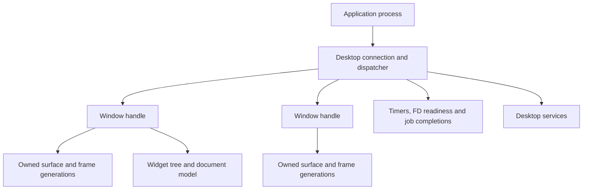

# Desktop architecture and API evolution

Reviewed 2026-10-24 against integration baseline `bc0edb9` (PR130).
This is a proposed implementation sequence, not an implemented API or a new
hardware acceptance claim. The [capacity contract](window-capacity.md) describes
the shipping sixteen-window implementation. The companion
[POSIX audit](posix-compatibility.md) covers the userspace foundation.

## Goal and boundary

Remove the small compile-time window-count ceiling. Applications should be able
to create windows until an explicit memory/resource budget refuses admission,
without corrupting existing windows, losing documents or freezing input.
“Unlimited windows” means dynamic allocation and useful refusal, not unlimited
RAM, unbounded queues or a promise that every workload fits on every machine.

The next step is object identity and lifetime, not another increase to
`DESK_MAX_WINDOWS`. A process currently identifies a desktop client and effectively
one window. That coupling also limits dialogs, multiple documents and application
activation. Dynamic arrays alone would preserve the wrong public contract.

Keep the native desktop, software renderer and reusable widget library. A GPU,
full POSIX implementation or a port of a large external toolkit is not a
prerequisite for multiple windows per application.

## Existing architecture

| Layer and source | Current responsibility | Constraint to address |
| --- | --- | --- |
| [`kernel/src/gui.c`](../kernel/src/gui.c) | PID-addressed queues, one registered server, owned surfaces, atomic packet insertion/seal transitions | Fixed queue/surface tables; linear lookups; desktop packet knowledge in kernel |
| [`desktop_protocol.h`](../shared/include/srvros/desktop_protocol.h) | v12, 160-byte packets; configure/commit/release, input, titles, menus, services | No explicit connection/window identity or capability negotiation; kernel/userspace must match |
| [`desktop.c`](../userspace/lib/src/desktop.c) | Transport wrappers, process liveness, pixel allocation | Process-based routing and separate size ceilings |
| [`desk_app.h`](../userspace/lib/include/srvros/desk_app.h), [`desk_app.c`](../userspace/lib/src/desk_app.c) | One window's canvas, generations, pending input/frame, resize rollback, retry and menu state | Two instances would compete for one process queue; no connection-level dispatcher |
| [`deskd.c`](../userspace/deskd/deskd.c), [`scene.h`](../userspace/deskd/scene.h) | Launch, clients, frames, focus, stacking, input capture, presentation | Client lookup by PID; parallel slot arrays; slot-index actions and focus; child launch records coupled to windows |
| [`widgets/`](../userspace/widgets/README.md) | Pure models/controllers, layout and rendering primitives | Deliberately owns neither allocation, process transport nor an event loop; preserve that separation |
| Native apps and workers | Documents, workflows, asynchronous file/image jobs | Repeated application lifetime/dispatch logic; generally one window per process |

Useful existing guarantees must survive the migration: validate packet direction
and surface ownership; publish only sealed complete frames; reject stale
serials/generations; retain the last accepted frame on allocation failure; reserve
resize resources before committing geometry; cancel interrupted pointer capture;
drain accepted I/O before releasing its owner. The desktop's input deadlines,
control retry and asynchronous worker patterns are assets, not disposable demo
code.

## Capacity inventory

These are distinct budgets, not interchangeable definitions of “windows.”

| Current bound | Location / consequence |
| --- | --- |
| 16 windows and child launch slots | `DESK_MAX_WINDOWS`, `DESKD_WINDOWS`, session/scene arrays; one client per PID |
| 32 GUI queues, 64 messages per queue | `GUI_MAX_QUEUES = DESK_MAX_WINDOWS + 16`, `GUI_QUEUE_DEPTH`; process queues also need room for services |
| 64 GUI surfaces | `GUI_MAX_SURFACES = DESK_MAX_WINDOWS * 4`; surface count should follow active allocations, not window-count arithmetic |
| 96 MiB compositor pixel cache | Demand-allocated front/spare images; resize reservations and reclaimable spare policy already exist |
| 1440×900 logical client surface | Protocol/kernel bound; explicit 2× output is enlargement, not native-density text rendering |
| Clipboard transfer state per admitted client (D0 candidate) | No independent peer table; one global 64 KiB committed value and staged writer |
| 96 menu items / 32 visible group rows; 64 palette items | Shared menu/palette storage can become the next window-list ceiling even if compositor records grow |
| 32 application menu entries | Current action/menu protocol; separate from global window enumeration |
| 64 processes; originally 64 extra file slots plus standard streams, now 67 unified native descriptors in the POSIX branch | `kernel/include/srvros/process.h`; more windows should not require one new process each, and dynamic window admission does not remove other resource limits |
| 8 additional user-thread slots per process; 32 kernel scheduler-thread slots | `kernel/src/process.c`, `kernel/src/scheduler.c`; different resource pools, not a single universal task count |

The audit reproduced a clipboard gap: eight retained peers received replies,
and a ninth did not. D0 replaces the independent peer table with state owned by
each admitted client. Multi-peer host and actual-protocol VM coverage are required
before acceptance; the current machine record tracks their status. Window
admission and clipboard teardown must stay coupled during D1/D2 migration.

The 96 MiB cache statistic is not total desktop memory. Client canvases, kernel
surfaces, framebuffer backing, worker buffers, queues and metadata also cost RAM.
Admission must account for the peak during resize, including the old image, new
image and in-flight frame. Cache trace output is optional; the accepted native
sixteen-window round contains no cache totals.

## Combined wait contract (planned, not implemented)

The POSIX work supplies checked descriptor operations, poll/select and cooperative
signal-mask handling. A GUI connection is not yet a descriptor, and polling a
separate GUI queue remains a desktop limitation. Desktop D1/D3 should introduce
one kernel wait request containing native FD interests, an authenticated GUI
connection interest, an absolute monotonic deadline and a cancellation epoch.
Keep the public toolkit interface independent of the syscall layout.

The wait must inspect readiness and register its wake condition in the same
serialized kernel section. GUI enqueue/disconnect, FD readiness/close, worker
completion and cancellation must advance a generation and wake that wait. Recheck
all requested conditions after registration and each wake; a wake is not proof of
a ready event. Return a ready set without consuming messages or data. Drain a
bounded batch in the single connection dispatcher, distribute by stable window
handle, and recompute the nearest timer deadline before waiting again.

A child window must not introduce a second reader of the process queue. Completion
callbacks run on the dispatcher thread; file/device work remains in workers.
Preserve existing GUI sender authentication and surface ownership. During owned
storage I/O, combined waits must retain the current admission restrictions;
adding an FD interest cannot make a blocked filesystem syscall eligible. Avoid
re-entering lifecycle cleanup while another process owns I/O.

Acceptance must force GUI/FD/worker arrivals immediately before and after wait
registration, close/reuse and connection-epoch changes, timeout-zero probes,
signal interruption, cancellation and input under heavy I/O. Measure idle CPU and
p95/p99 dispatch latency. The current POSIX VM receipts do not establish this
future GUI wait contract or native input latency.

## Proposed object model and API contracts

1. **Connection:** authenticated process/endpoint ownership, negotiated protocol
   version/capabilities, request IDs, quotas and one queue dispatcher. A process
   has one main UI dispatcher initially; worker threads post completions to it.
   Explicitly document thread affinity and callback/reentrancy rules.
2. **Window:** opaque stable handle with generation/epoch, independent of PID,
   array index, document or surface. It owns geometry, role, visibility, focus,
   capture and actions. An app can have multiple document windows, utility
   windows and parented/transient dialogs. Closing one does not kill its siblings.
3. **Surface:** independently owned buffer handle with checked dimensions,
   format/stride, byte accounting, commit serial and release acknowledgement.
   A window may replace surfaces without changing identity. Never reuse a handle
   while a queued event or old client can mistake it for the previous object.
4. **Document/application:** stable app ID, process lifetime and document identity
   separate from window identity. Quit, close, save, reopen and activation have
   different semantics. A busy writer can defer close; it cannot silently lose
   ownership because a window disappears.
5. **Services:** clipboard, launch/open-document, file chooser, notifications and
   preferences have request/reply/cancellation contracts. Focus-sensitive actions
   carry an input serial and window identity. Connections may share clipboard
   transfer bookkeeping, but authorization must use the actual focused window.

Every create/request needs a correlated success or typed failure, including
unsupported capability, invalid handle, queue pressure, budget exhaustion and
server loss. Reserve delivery capacity for lifecycle/control replies; bounded
queues cannot promise an error by enqueueing into the same already-full queue.
Use per-connection credits, coalescing where safe and fair scheduling. Never
coalesce text/key transitions or confuse cancellation with a click release.

Version the migration deliberately. Introduce the next matched protocol revision
with explicit window IDs, update kernel/server/client together, and retain a
single-window source wrapper while apps migrate. Reject incompatible connections
clearly. Do not freeze an external binary ABI prematurely or promise that old
applications can be mixed into a new staged image.

The existing kernel seal/ownership checks remain necessary. A more generic IPC
transport may eventually move window-policy parsing out of the kernel, but it
must preserve atomic queue/seal transitions and cannot trust a client-supplied
owner or raw pointer. That extraction is a separate reviewed change.

## APIs to mature

| Area | First useful contract | Later expansion / boundary |
| --- | --- | --- |
| Application loop | Dispatch all windows, timer deadlines, FD readiness and job completion; bounded work per iteration; one blocking wait | Integrate GUI wakeups with kernel waits; avoid a polling loop per window |
| Windows | Create/destroy acknowledgements, title/app ID, geometry, min/max size, close negotiation, minimize/maximize/fullscreen, focus/visibility events | Transient parents, modality and activation policy; no arbitrary focus stealing |
| Rendering | Explicit configure acknowledgement, frame/damage submission, frame-ready pacing and release ownership | Logical/device coordinates, output changes, native-density fonts; optional acceleration later |
| Input | Window-targeted key/text/pointer/scroll events, capture/cancel, shortcut actions and secondary clicks | Text composition/IME, grapheme-aware editing, keyboard focus traversal and accessibility semantics |
| Actions/menus | Stable action IDs and enable/check/shortcut state shared by menu, toolbar and keyboard | Dynamic window enumeration, searchable app commands and global menu overflow |
| Clipboard / drag-drop | Typed offers and bounded asynchronous transfer with completion/refusal, cancellation and ownership lifetime | Multiple MIME types and drag/drop; do not expose arbitrary client pointers |
| Documents / files | Open/save dialogs, explicit accepted-write lifetime, dirty state and save-on-close | Recent documents, session recovery and file-change notifications; crash recovery is not exFAT journaling |
| App services | Launch/activate/open-document by app ID; structured errors; notifications and settings | Application manifests and associations replace the hardcoded launcher catalog |
| Toolkit | Continue shared controls; add layout constraints, focus/action plumbing and consistent theme metrics | Virtualized collections, accessible roles and text shaping; keep transport and allocation out of pure widget models |
| Observability | Per-owner allocations, queue depths/drops, input latency, frame time, refusal reason and teardown totals | Workload-based profiling and reproducible regression thresholds |

Use other desktops as contract references rather than copy their entire stack.
Wayland's official [protocol model](https://wayland.freedesktop.org/docs/book/Protocol.html)
demonstrates typed objects and asynchronous requests/events. Qt's
[QWindow API](https://doc.qt.io/qt-6/qwindow.html) is a useful checklist for window
lifetime, parent/transient relationships, visibility and output scale. These
references do not imply Wayland wire compatibility or a supported Qt port.

## Implementation blocks and acceptance gates

### D0 — Make current contracts honest

Add multi-peer clipboard coverage, explicit capacity/refusal diagnostics and a
single inventory of resource budgets. Record application/connection/window counts
separately. Preserve existing 16-window and allocation-pressure regressions.
Fix service ceilings that are already below the advertised workload. This block
does not require a protocol redesign or a new hardware reboot.

### D1 — Separate windows from processes

Implement explicit window handles, a connection dispatcher and a multi-window
client API while retaining the current capacity. Migrate one real app (Text:
two documents) and provide the old one-window wrapper. Update input, capture,
menus, clipboard authorization, resize and cleanup together.

**Gate:** two windows in one process receive only their own events; closing one
preserves the other document. Cover rejected creation, server death, client death,
queued stale events, handle reuse, parent close, save deferral and failed resize.
Tests must exercise the actual kernel/client/compositor protocol, not only mocks.

### D2 — Allocate registries dynamically

Replace client/scene/child arrays with stable object storage and explicit maps,
separate z-order from storage, and remove slot indices from UI actions. Grow kernel
queue/surface records independently under quotas. Prepare allocation outside
long interrupt-disabled sections and publish changes transactionally. Paginate
or virtualize window menus/palette; grow clipboard peer state with connections.
Keep bounded work per frame and fair per-connection service under flood.

**Gate:** VM workloads with 32, 64 and 128 small windows in one/few processes,
plus mixed independent apps, within recorded budgets. These are stress points,
not new hardcoded maxima. Inject allocation failure at each creation/resize
stage; all previously accepted windows, documents and input remain valid.
Verify queue saturation, stale IDs, close/reopen churn, resource reclamation and
server shutdown. Refusal must be visible and explain the exhausted resource.
Measure p95/p99 input-to-dispatch and frame latency under idle and heavy I/O;
compare against the same pre-change workload, dimensions and VM configuration.

Follow with one focused native round on the Air: mixed windows, menus/clipboard,
resize, saving and exit/reopen, with on-screen instructions and persisted
resource totals. VM scale evidence does not accept physical gestures or latency.

### D3 — Share the application runtime and desktop services

Build a small allocating application layer above the pure widgets: event loop,
actions, multiple windows, document lifecycle and job ownership. Migrate remaining
apps incrementally. Add transient dialogs, reusable chooser APIs and app
activation/open-document routing. Preserve the quiet, refined native style.

**Gate:** two apps use the same contracts without copied lifecycle code; cancel
and failed saves retain data; background work does not block typing; last-window
close and explicit Quit obey documented policy. Service errors are recoverable.

### D4 — Rendering, text and accessibility

Add frame pacing/damage contracts, output scale queries, native-density text,
keyboard-only navigation and semantic accessibility data. Specify composition,
selection and grapheme behavior before growing text APIs. GPU work is independently
measured and optional. Use profiler evidence before changing the compositor's
pixel-copy architecture.

**Gate:** text/input conformance fixtures, mixed-scale geometry tests, predictable
keyboard focus, no stale pixels, and measured rendering/input improvements.

### D5 — External toolkit portability

Choose one bounded consumer/backend after the POSIX prerequisites are reliable
(for example a small event-driven C GUI program). Define its required subset and
port it end to end. Evaluate SDL/Wayland/large-toolkit integration from measured
needs; do not commit to a full Qt/GTK/browser port based on symbol availability.

## Dependencies and coordination

D0 and the POSIX audit's first correctness fixes can land independently. D1 must
precede D2; otherwise every fixed array conversion has to be repeated when
identity changes. D3 depends on D1 and the combined-wait/error contracts, but does
not need `fork`, dynamic loading or full POSIX conformance. D4 is incremental;
D5 requires an explicitly tested portability profile.

The Air7,2 agent owns this architecture proposal. Publish a new bounded scope
before implementation across protocol, kernel GUI and client libraries. Device
agents continue their independent drivers/profiles and consume matched merged
images. Pro11,2 PR19 is Wi-Fi work; this plan does not take over that scope.

Current evidence remains the PR130 host/VM regressions and Air sixteen-window
opening on `bf68e4e9b88b8ae7`. Nothing in this proposal claims dynamic windows,
multi-window applications or new POSIX behavior is implemented yet.
