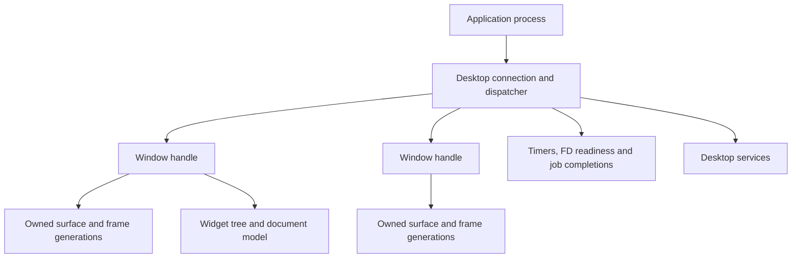

# Desktop architecture and API evolution

Reviewed 2026-10-24 against integration baseline `bc0edb9` (PR130); D0/D1
progress and D2/D3 implementation plus D4a rendering updated 2026-10-26. Later blocks remain proposals, not implemented APIs
or new hardware acceptance claims. The [capacity contract](window-capacity.md) describes
current dynamic storage and the separately scoped physical acceptance. The companion
[POSIX audit](posix-compatibility.md) covers the userspace foundation.

## Goal and boundary

Remove the small compile-time window-count ceiling. Applications should be able
to create windows until an explicit memory/resource budget refuses admission,
without corrupting existing windows, losing documents or freezing input.
“Unlimited windows” means dynamic allocation and useful refusal, not unlimited
RAM, unbounded queues or a promise that every workload fits on every machine.

D1 separates object identity and lifetime from processes before changing
`DESK_MAX_WINDOWS`. A connection now dispatches multiple window identities, and
normal Text exercises independent real documents. Other apps retain the source
compatibility wrapper. Dynamic allocation must preserve these ownership contracts.

Keep the native desktop, software renderer and reusable widget library. A GPU,
full POSIX implementation or a port of a large external toolkit is not a
prerequisite for multiple windows per application.

## Existing architecture

| Layer and source | Current responsibility | Constraint to address |
| --- | --- | --- |
| [`kernel/src/gui.c`](../kernel/src/gui.c) | PID-addressed queues, one registered server, owned surfaces, atomic packet insertion/seal transitions | Dynamic queues/surface records with byte budgets; linear lookups; desktop packet knowledge in kernel |
| [`desktop_protocol.h`](../shared/include/srvros/desktop_protocol.h) | v15, 168-byte packets with explicit window ID and owned dialogs; configure/commit/release, input, titles, menus, document routing | Opt-in creation/close acknowledgements; retain matched kernel/userspace; broader capability negotiation remains later |
| [`desktop.c`](../userspace/lib/src/desktop.c) | Transport wrappers, process liveness, pixel allocation | Process-based routing and separate size ceilings |
| [`desk_app.h`](../userspace/lib/include/srvros/desk_app.h), [`desk_app.c`](../userspace/lib/src/desk_app.c) | Per-window canvas, generations, frames, resize rollback and menus | Connection dispatcher now available; migrate normal apps from the compatibility wrapper |
| [`deskd.c`](../userspace/deskd/deskd.c), [`scene.h`](../userspace/deskd/scene.h) | Launch, clients, frames, focus, stacking, input capture, presentation | Stable dynamically allocated records and independent child storage; lifetime-safe UI actions; linear lookup/stacking remains |
| [`widgets/`](../userspace/widgets/README.md) | Pure models/controllers, layout and rendering primitives | Deliberately owns neither allocation, process transport nor an event loop; preserve that separation |
| Native apps and workers | Documents, workflows, asynchronous file/image jobs | Text shares one connection across documents; Text/Files use bounded lazy file-worker pools; other apps retain the compatibility wrapper |

Useful existing guarantees must survive the migration: validate packet direction
and surface ownership; publish only sealed complete frames; reject stale
serials/generations; retain the last accepted frame on allocation failure; reserve
resize resources before committing geometry; cancel interrupted pointer capture;
drain accepted I/O before releasing its owner. The desktop's input deadlines,
control retry and asynchronous worker patterns are assets, not disposable demo
code.

## Capacity inventory

These are distinct budgets, not interchangeable definitions of “windows.”

| Current bound | Location / consequence |
| --- | --- |
| Dynamic compositor windows and child connections | Stable chunks, 8 MiB additional metadata budget including replacement table overlap; inline sixteen records remain bootstrap storage |
| Dynamic GUI queues, 64 messages per queue | 2 MiB requested-byte budget includes prepared/retired records; process and window budgets remain independent |
| Dynamic GUI surfaces | 256 KiB record budget plus 256 MiB pixel budget, including in-flight reservations and retirement; no fixed surface slot array |
| 96 MiB compositor pixel cache | Demand-allocated front/spare images; resize reservations and reclaimable spare policy already exist |
| 1440×900 logical client surface | Protocol/kernel bound; explicit 2× output is enlargement, not native-density text rendering |
| Clipboard transfer state per admitted client (D0 merged) | No independent peer table; one global 64 KiB committed value and staged writer |
| Menu/palette caller-owned storage | Inline defaults remain 96/32 and 64; compositor grows storage to enumerate all admitted windows; shared list geometry bound 4096 |
| 32 application menu entries | Current action/menu protocol; separate from global window enumeration |
| 64 processes and 67 unified native descriptors per process | `kernel/include/srvros/process.h`; more windows should not require one new process each, and dynamic window admission does not remove other resource limits |
| 8 additional user-thread slots per process; scheduler records grow from 32 bootstrap entries under a 32 MiB storage budget | `kernel/src/process.c`, `kernel/src/scheduler.c`; different resource pools, not a single universal task count |

The audit reproduced a clipboard gap: eight retained peers received replies,
and a ninth did not. D0 replaces the independent peer table with state owned by
each admitted client. Runtime `18d92f1` passes multi-peer host and actual-protocol VM coverage on
this branch; the current machine record tracks integration and native status. Window
admission and clipboard teardown must stay coupled during D1/D2 migration.

The 96 MiB cache statistic is not total desktop memory. Client canvases, kernel
surfaces, framebuffer backing, worker buffers, queues and metadata also cost RAM.
Admission must account for the peak during resize, including the old image, new
image and in-flight frame. Cache trace output is optional; the accepted native
sixteen-window round contains no cache totals.

## Admission during continuous disk work

An I/O wake makes a blocked allocation or cleanup call runnable; it does not
mean the call has entered the kernel operation. The scheduler records pending
admission for explicit gate waiters and READY threads actually excluded by the
gate, including fresh process entries and post-exit kernel cleanup. A nonblocking
child wait or explicit nonblocking pipe/PTY read or write deferred by another
I/O owner also requests a turn while returning immediately. Pipe operations
still return AGAIN without entering descriptor/signal cleanup under that owner;
both worker request submission and reply consumption need this retry admission.
Requests are coalesced and consumed only when selected with no I/O
owner; an eligible service turn during owned I/O does not consume them. A later
exclusion records a fresh request. Sleeping threads are not woken by this policy.

After a userspace syscall that required the I/O gate finishes, its now user-safe
caller hands off to one ready admission contender before submitting another
operation. GUI/audio-safe calls keep their normal service turns without this
extra handoff.

The handoff requires zero I/O ownership depth and a fully unwound syscall. It
never releases a transaction early or broadens the I/O-safe syscall whitelist.
Nested ownership, sibling exclusion, resource validation and cancellation remain
in force. Cancellation is checked again after the handoff, and forced retirement
removes a waiter's pending admission. This prevents a fast writer repeatedly
reacquiring ownership ahead of calls it woke; it does not promise that arbitrarily
slow storage can satisfy the existing desktop deadlines.

## Combined wait contract (D3b)

The D3b implementation provides one wait for an authenticated GUI server and up
to eight explicit nonblocking pipe/PTY interests. It uses an absolute monotonic
deadline, bounded to one second ahead, and a process-local cancellation epoch.
Zero/past deadlines probe immediately. The ready set reports GUI messages,
descriptor events, cancellation, peer loss or deadline without consuming data.
This is a native desktop primitive; it does not turn GUI connections into POSIX
file descriptors or extend arbitrary VFS/network polling during owned I/O.

The kernel copies immutable interests once, captures descriptor lifetime
generations, then checks readiness and registers the common wake queue with IRQs
masked. Close/dup2 publication invalidates old descriptor watches even when the
numeric FD or underlying endpoint is reused. Generations saturate, never wrap.
GUI enqueue/disconnect, pipe changes, cancellation and signals wake the same
queue. Spurious wakes recheck readiness and the absolute deadline. Cancellation
is acknowledged by the connection helper's observed epoch; it does not cancel
accepted file mutations or create a second queue reader.

`desk_connection_wait_io` and `desk_app_wait_io` require fully published,
quiescent windows. The caller owns timer/clipboard/control deadlines and keeps
bounded dispatch batches. `desk_file_pool_interests` supplies active worker
transport interests; queued work needing a lease, a complete buffered reply and
child retirement retain a short dispatch retry. Text/Files use this path.
During owned storage I/O, normal pipe readiness is suppressed (the actual try
read/write would defer), but GUI/cancel/descriptor invalidation still return.
The wait rechecks deferred pipes within one scheduler tick without entering
filesystem cleanup. General POSIX poll admission is unchanged.

Focused host fixtures cover immutable snapshots, registration/spurious races,
simultaneous readiness, descriptor close/reuse, copy faults, cancellation, signal
interruption and partial-tick deadlines. Actual-ABI and application QEMU gates
must be read from the machine record. Idle CPU and p95/p99 latency profiling,
physical input latency and broader desktop service integration remain pending.

## Proposed object model and API contracts

1. **Connection:** authenticated process/endpoint ownership, negotiated protocol
   version/capabilities, request IDs, quotas and one queue dispatcher. A process
   has one main UI dispatcher initially; worker threads post completions to it.
   Explicitly document thread affinity and callback/reentrancy rules.
2. **Window:** opaque stable handle with generation/epoch, independent of PID,
   array index, document or surface. It owns geometry, role, visibility, focus,
   capture and actions. An app can have multiple document windows, utility
   windows and parented/transient dialogs. Closing one does not kill its siblings.
3. **Surface:** independently owned buffer handle with checked dimensions,
   format/stride, byte accounting, commit serial and release acknowledgement.
   A window may replace surfaces without changing identity. Never reuse a handle
   while a queued event or old client can mistake it for the previous object.
4. **Document/application:** stable app ID, process lifetime and document identity
   separate from window identity. Quit, close, save, reopen and activation have
   different semantics. A busy writer can defer close; it cannot silently lose
   ownership because a window disappears.
5. **Services:** clipboard, launch/open-document, file chooser, notifications and
   preferences have request/reply/cancellation contracts. Focus-sensitive actions
   carry an input serial and window identity. Connections may share clipboard
   transfer bookkeeping, but authorization must use the actual focused window.

Every create/request needs a correlated success or typed failure, including
unsupported capability, invalid handle, queue pressure, budget exhaustion and
server loss. Reserve delivery capacity for lifecycle/control replies; bounded
queues cannot promise an error by enqueueing into the same already-full queue.
Use per-connection credits, coalescing where safe and fair scheduling. Never
coalesce text/key transitions or confuse cancellation with a click release.

Version the migration deliberately. Introduce the next matched protocol revision
with explicit window IDs, update kernel/server/client together, and retain a
single-window source wrapper while apps migrate. Reject incompatible connections
clearly. Do not freeze an external binary ABI prematurely or promise that old
applications can be mixed into a new staged image.

The existing kernel seal/ownership checks remain necessary. A more generic IPC
transport may eventually move window-policy parsing out of the kernel, but it
must preserve atomic queue/seal transitions and cannot trust a client-supplied
owner or raw pointer. That extraction is a separate reviewed change.

## APIs to mature

| Area | First useful contract | Later expansion / boundary |
| --- | --- | --- |
| Application loop | Dispatch all windows, timer deadlines, FD readiness and job completion; bounded work per iteration; one blocking wait | Integrate GUI wakeups with kernel waits; avoid a polling loop per window |
| Windows | Create/destroy acknowledgements, title/app ID, geometry, min/max size, close negotiation, minimize/maximize/fullscreen, focus/visibility events | Transient parents, modality and activation policy; no arbitrary focus stealing |
| Rendering | Explicit configure acknowledgement, frame/damage submission, frame-ready pacing and release ownership | Logical/device coordinates, output changes, native-density fonts; optional acceleration later |
| Input | Window-targeted key/text/pointer/scroll events, capture/cancel, shortcut actions and secondary clicks | Text composition/IME, grapheme-aware editing, keyboard focus traversal and accessibility semantics |
| Actions/menus | Stable action IDs and enable/check/shortcut state shared by menu, toolbar and keyboard | Dynamic window enumeration, searchable app commands and global menu overflow |
| Clipboard / drag-drop | Typed offers and bounded asynchronous transfer with completion/refusal, cancellation and ownership lifetime | Multiple MIME types and drag/drop; do not expose arbitrary client pointers |
| Documents / files | Open/save dialogs, explicit accepted-write lifetime, dirty state and save-on-close | Recent documents, session recovery and file-change notifications; crash recovery is not exFAT journaling |
| App services | Launch/activate/open-document by app ID; structured errors; notifications and settings | Application manifests and associations replace the hardcoded launcher catalog |
| Toolkit | Continue shared controls; add layout constraints, focus/action plumbing and consistent theme metrics | Virtualized collections, accessible roles and text shaping; keep transport and allocation out of pure widget models |
| Observability | Per-owner allocations, queue depths/drops, input latency, frame time, refusal reason and teardown totals | Workload-based profiling and reproducible regression thresholds |

Use other desktops as contract references rather than copy their entire stack.
Wayland's official [protocol model](https://wayland.freedesktop.org/docs/book/Protocol.html)
demonstrates typed objects and asynchronous requests/events. Qt's
[QWindow API](https://doc.qt.io/qt-6/qwindow.html) is a useful checklist for window
lifetime, parent/transient relationships, visibility and output scale. These
references do not imply Wayland wire compatibility or a supported Qt port.

## Implementation blocks and acceptance gates

### D0 — Make current contracts honest

Add multi-peer clipboard coverage, explicit capacity/refusal diagnostics and a
single inventory of resource budgets. Record application/connection/window counts
separately. Preserve existing 16-window and allocation-pressure regressions.
Fix service ceilings that are already below the advertised workload. This block
does not require a protocol redesign or a new hardware reboot.

### D1 — Separate windows from processes

Implement explicit window handles, a connection dispatcher and a multi-window
client API while retaining the current capacity. Migrate one real app (Text:
two documents) and provide the old one-window wrapper. Update input, capture,
menus, clipboard authorization, resize and cleanup together.

**Gate:** two windows in one process receive only their own events; closing one
preserves the other document. Cover rejected creation, server death, client death,
queued stale events, handle reuse, parent close, save deferral and failed resize.
Tests must exercise the actual kernel/client/compositor protocol, not only mocks.

D1a/b are merged in PR141/142 and normal Text migration in PR143:
`f4f4c9c` passes actual multi-document save/close/reopen/launcher and sixteen-document
refusal/reuse/exact persistence gates. Parented/transient dialogs are not yet an
API; their acceptance follows D3. Native gesture/latency acceptance is separate.

### D2 — Allocate registries dynamically

D2a/b are merged in PR144/145: kernel surface/queue slots have been replaced
with byte-budgeted stable storage. D2c merged through PR146 (`bba1c39` runtime) implements stable
compositor chunks, separate child growth, reusable scene scratch and complete
menu/palette enumeration. Host/full-build gates pass; QEMU/native acceptance
must be read from the current machine record. D2 latency/large-workload profiling
and native acceptance remain distinct from storage correctness.

Replace client/scene/child arrays with stable object storage and explicit maps,
separate z-order from storage, and remove slot indices from UI actions. Grow kernel
queue/surface records independently under quotas. Prepare allocation outside
long interrupt-disabled sections and publish changes transactionally. Paginate
or virtualize window menus/palette; grow clipboard peer state with connections.
Keep bounded work per frame and fair per-connection service under flood.

**Gate:** VM workloads with 32, 64 and 128 small windows in one/few processes,
plus mixed independent apps, within recorded budgets. These are stress points,
not new hardcoded maxima. Inject allocation failure at each creation/resize
stage; all previously accepted windows, documents and input remain valid.
Verify queue saturation, stale IDs, close/reopen churn, resource reclamation and
server shutdown. Refusal must be visible and explain the exhausted resource.
Measure p95/p99 input-to-dispatch and frame latency under idle and heavy I/O;
compare against the same pre-change workload, dimensions and VM configuration.

Follow with one focused native round on the Air: mixed windows, menus/clipboard,
resize, saving and exit/reopen, with on-screen instructions and persisted
resource totals. VM scale evidence does not accept physical gestures or latency.

### D3 — Share the application runtime and desktop services

D3a implements reusable file-worker ownership for Text/Files: caller-owned
job records, lazy bounded transport leases, FIFO admission and drain/reap before
application exit. This removes per-document worker allocation without claiming
all desktop services are complete. D3b adds the bounded GUI/pipe/PTY wait
contract above. D3c shares an asynchronous [file chooser controller](desktop-chooser.md)
between Text and Preview, preserving canceled-read ownership and correlating
completion before reuse; source acceptance is recorded per machine.

D3d implements the [shared runtime block](desktop-application-runtime.md):
bounded dispatch, caller-owned deadlines/timers, worker-readiness wait preparation
and standard command snapshots for Text and Preview. It does not allocate app
models or own their accepted file/image jobs. See its validation and unit record
for implementation evidence and physical acceptance.

D3e adds the optional [allocating window/model layer](desktop-window-ownership.md)
above pure widgets. It shares stable model admission, main/owned-dialog routing,
sequential cancellable Quit and explicit drained-work release across normal Text
and Files. Files can create sibling windows in one process, with independent
navigation and one bounded file-worker pool. Rename/duplicate/delete use owned
dialogs with refusal fallback. Terminal uses the shared runtime, PTY readiness
and command snapshots while retaining shell control keys and separate session
processes. No protocol revision or resource-budget change is introduced.

Host and actual-consumer VM gates cover these contracts. Native acceptance of
the new layer remains separate in the machine record. Migrate remaining apps
incrementally; application manifests, broader services and external toolkit
backends remain future work. Preserve the quiet, refined native style.

**Gate:** two apps use the same contracts without copied lifecycle code; cancel
and failed saves retain data; background work does not block typing; last-window
close and explicit Quit obey documented policy. Service errors are recoverable.

### D4 — Rendering, text and accessibility

D4a prepares one stack ordering per frame and conservatively skips fully covered
opaque window frames/shadows. The unculled path remains an exact pixel oracle;
identical host workloads measure writes and timing. See the [rendering
contract](native-desktop.md#repainting-and-covered-windows) and machine record
for source/VM acceptance. Damage policy, framebuffer copying and surface lifetime
are unchanged. This is an overdraw reduction, not completion of this roadmap.

Add frame pacing/damage contracts, output scale queries, native-density text,
keyboard-only navigation and semantic accessibility data. Specify composition,
selection and grapheme behavior before growing text APIs. GPU work is independently
measured and optional. Use profiler evidence before changing the compositor's
pixel-copy architecture.

**Gate:** text/input conformance fixtures, mixed-scale geometry tests, predictable
keyboard focus, no stale pixels, and measured rendering/input improvements.

### D5 — External toolkit portability

Choose one bounded consumer/backend after the POSIX prerequisites are reliable
(for example a small event-driven C GUI program). Define its required subset and
port it end to end. Evaluate SDL/Wayland/large-toolkit integration from measured
needs; do not commit to a full Qt/GTK/browser port based on symbol availability.

## Dependencies and coordination

D0 and the POSIX audit's first correctness fixes can land independently. D1 must
precede D2; otherwise every fixed array conversion has to be repeated when
identity changes. D3 depends on D1 and the combined-wait/error contracts, but does
not need `fork`, dynamic loading or full POSIX conformance. D4 is incremental;
D5 requires an explicitly tested portability profile.

The Air7,2 agent owns this architecture proposal. Publish a new bounded scope
before implementation across protocol, kernel GUI and client libraries. Device
agents continue their independent drivers/profiles and consume matched merged
images. Pro11,2 PR19 is Wi-Fi work; this plan does not take over that scope.

D0–D2 and D3a are merged through PR140–147. D3b's combined wait is in
PR148, D4a repaint work in PR149, and D3c's shared chooser in PR150. Current host/QEMU evidence includes 128 small windows, 32 normal Text
documents/33 exact files, worker fault/reap behavior and actual wait/input-under-I/O
fixtures. Air7,2 subsequently accepted bounded native 24-window workloads and
mixed services; see its [unit record](machines/macbookair7-2.md) for exact releases
and limits. Larger workloads, energy and latency still require their own trials.
The selected POSIX profile has its own acceptance record and remaining gaps.

D3 follow-up merged in PR157; later lifecycle fixes and the Air7,2 modal/unsaved
retest are recorded in its unit record and the
[application lifecycle contract](desktop-application-lifecycle.md): same-process
parented dialogs, sequential cancellable app Quit, and bounded existing-process
open-document routing. These are matched protocol v15 changes. Host validation
and actual consumer/VM acceptance must be read from the current checkpoint.
