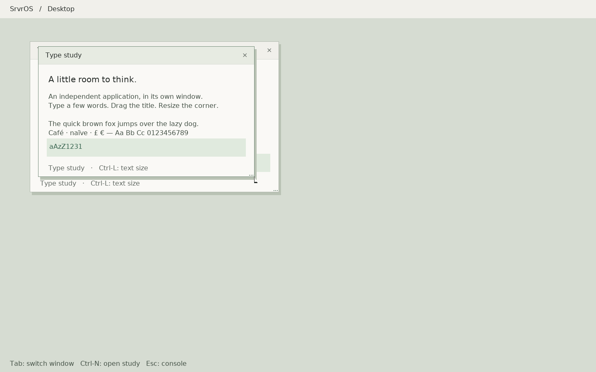

# Native compositor and independent client

Follow-up: the [physical capture workflow](trackpad-capture-2026-10-17.md) adds
an interactive boot, bounded raw packet samples, USB reports and a persistent
halt screen. Its first physical capture passed; see the linked result for evidence.

This advances the [desktop plan](desktop-plan-2026-10-17.md) beyond the single
process rendering study. The new compositor and test application run as separate
ring-3 processes. The capture transport for the built-in trackpad is implemented
and remains opt-in. Physical packet capture is now verified; pointer/gesture
behavior is still pending. Building this work does not install
a hardware release or change the laptop's boot entry.



## Programs and boundaries

- `/fat/bin/deskd` owns composition, decorations, stacking, focus and input routing.
  Its scene module draws from private window caches. The first session accepts at
  most two study processes that it launched, rather than exposing an unrestricted
  application launcher. It does not use the old GUI toolkit.
- `/fat/bin/deskclient` renders its own content using the shared native renderer.
  It is a typing/layout study, not a text editor; it does not save files.
- `shared/include/srvros/desktop_protocol.h` defines the versioned payload.
  `userspace/lib/src/desktop.c` supplies transport, mapped pixel storage and
  process-liveness helpers. Pixel allocations use anonymous mappings to avoid
  exhausting the existing small `brk` heap with the root display and resize caches.
- The old `deskstudy` stays a renderer laboratory. The old GUI programs remain
  historical implementations pending the plan's replacement gate.

From the monitor in the newly built image:

```text
run /fat/bin/deskd
```

Type in the focused study; Tab switches windows, Ctrl-N opens the second study,
Ctrl-L changes text size in the focused application, and Escape ends the session.
Drag a title bar to move a window, its lower-right corner to resize, or use its
close control. These Control/Tab shortcuts are temporary exercises of the current
character input ABI, not the planned Command/Meta desktop shortcut contract.
The programs' `--license` option prints the bundled font notice.

## Buffer ownership and resize

The payload has its own version and size inside the existing GUI envelope. The
kernel supplies the sender PID and rejects unknown versions/types, reserved bits,
forged releases, commits from another surface owner, mismatched dimensions and
replayed submission serials. Existing GUI messages and ordinary surfaces keep
their previous behavior.

1. The client opens a window; the compositor replies with a requested content
   size and configuration generation.
2. The client renders into its own RAM, copies into an owner-checked stream
   surface, and submits `COMMIT` with that surface, generation and serial.
3. Successful queue insertion atomically seals the surface. Neither its owner
   nor the compositor may write to or destroy it while sealed.
4. The compositor copies a matching frame into a new private cache. A failed
   partial copy cannot replace the displayed cache. It releases obsolete resize
   generations too, but does not display them.
5. Successful `RELEASE` queue insertion unseals the surface. The client waits for
   that acknowledgement before reuse or replacement. Release means the snapshot
   has been copied, not that scanout has completed.

A full queue leaves the seal transition unchanged and retryable. Release retries
precede configure messages; outstanding resize requests are coalesced. A client
keeps only one submitted frame outstanding and waits for release before replacing
its surface. Moving or uncovering a window uses the compositor's cache, without
requiring the application to repaint.

The compositor checks for dead clients and bounds waits for a configure response,
queue progress or close. It terminates an unresponsive study it owns after 500
scheduler ticks. Normal session shutdown has a bounded grace period. Kernel exit
cleanup frees queues/surfaces, drops server ownership and unseals outstanding
surfaces on compositor death. Clients detect server exit; framebuffer-console
ownership also recovers after an abrupt server exit.

## Trackpad capture transport

The new boot token is `srvros.trackpad=capture`. It is **absent from the normal
boot configuration**. It enables only the observed full-speed `05ac:0291`
Wellspring 8 interface 2, alternate setting 0, interrupt endpoint `0x83`.

The existing keyboard endpoint remains on DCI 5. Trackpad DCI 7 has its own ring,
DMA buffer, pending request, completion matching and report counters on the same
USB slot. Its configure command adds only DCI 7 and the slot context, preserving
the keyboard and hub routing state. Allocation/configuration failure does not
start polling the new endpoint; DMA remains reserved after an ambiguous command
timeout. Transfer errors stop that endpoint rather than repeatedly resubmitting
a stalled transfer.

The endpoint's USB packet/ESIT size remains 64 bytes. The request capacity is 486
bytes (38-byte header plus sixteen 28-byte contacts). Actual length comes from
the transfer completion residual; short packets are decoded using that length.
Completion matching includes slot, DCI and TRB pointer, independently of keyboard
and storage requests. Capture does not inject pointer events or enable gestures.

With that opt-in image booted, move a finger, lift it, and physically click the
trackpad, then run `xhci` in the monitor. The `trackpad-capture` lines show readiness,
request/actual length, successful frames, contact/button frame counts, malformed
reports and transfer errors. Current coordinates are live state and may return
to zero after lifting. Use keyboard input throughout to verify coexistence.
The dedicated capture workflow has since passed this physical gate. Contact
tracking and gesture policy are next. The [decoder reference and device inventory](desktop-foundation-2026-10-17.md#trackpad-evidence-and-next-integration)
remain the basis for the Type 3 format; synthetic tests are not hardware evidence.

## Verification

```sh
make test-core
tools/host-env.sh make -j4 all
tools/host-env.sh python3 tools/desktop_compositor_smoke.py --resolution 1440x900
tools/host-env.sh python3 tools/desktop_compositor_smoke.py --resolution 640x480
```

The host suite passes, including GUI seal/release ownership, full queues, replay,
server/client exit, clipped overlapping windows, full/tiled pixel equality,
stride guards, stale resize release, a failed partial copy, and unresponsive
client retirement. GUI, scene and session tests also pass ASan/UBSan.
The launch bookkeeping also handles a background child already reaped by another
system waiter; this race was found during the lifecycle smoke and has a host
regression test.

The xHCI host tests use the actual Apple configuration descriptor and synthetic
transfer events. They cover opt-in/exact-device selection, truncated descriptors,
32/64-byte contexts, independent keyboard/trackpad state, multi-packet request
length, lift/malformed reports, stale pointers, wrong DCIs and coexistence with a
pending storage transfer. Existing storage and keyboard regressions pass.

QEMU passes at 1440×900 and 640×480 with two independent applications, exact
mixed-case text, focus switching, overlap, drag, resize, close, normal shutdown,
client kill/replacement, abrupt compositor exit, console restoration and relaunch.
The harness records serial logs and screenshots under `build/review/desktop-*`.
Idle two-second sessions have only 2–3 presents for initial background/window/frame
publication. At 1440×900 the three-present session writes 6,998,272 framebuffer
bytes; it does not continuously repaint.

## Still open

D1 is advanced, not fully accepted: microsecond raster/copy/presentation timing,
physical input latency, sustained resize/typing under I/O, and event-driven waits
are still required. The current loop sleeps one scheduler tick when idle. Full
surface uploads and private snapshots deliberately favor simple ownership over
zero-copy throughput. Surface sizes are capped at 960×640; the compositor supports
640×480 through 3840×2160 framebuffers, with only the two listed modes tested here.

The input payload still carries decoded console bytes. Raw key up/down, modifiers,
wheel events, cancellation, focus notifications to applications and complete
display/input ownership remain future work. `DESK_FOCUS` is reserved, not emitted.
This is not yet the shared widget toolkit, Files/Text/Terminal, or a usable
built-in trackpad. The subsequent capture checkpoint accepts the physical
transport only; desktop interaction acceptance remains open.
