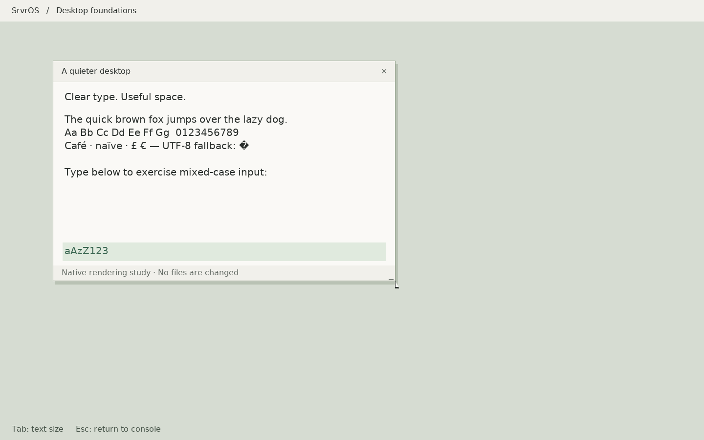

# Native desktop foundation: first implementation

This is the first implementation slice of the
[MacBook Air desktop plan](desktop-plan-2026-10-17.md), not completion of D1 or
the new desktop. It introduces a reusable renderer and an opt-in native study
that can be exercised independently of the old GUI toolkit. No hardware boot
profile is changed by building it.



## Implemented

- A RAM renderer with clipped rectangles and grayscale glyph blending. Text has
  independent glyphs for upper/lowercase, measured proportional advances, line
  metrics, UTF-8 decoding and an explicit replacement glyph for unsupported or
  malformed text. The initial atlas covers ASCII, Latin-1, selected punctuation,
  the euro sign and U+FFFD at 16 and 20 pixels. It does not implement shaping,
  kerning, arbitrary font sizes or complete Unicode coverage.
- A bounded damage accumulator with overlap merging and full-frame fallback
  when fragmentation exceeds its capacity. Drawing respects damage as well as
  presentation, and pixel-write counters expose overdraw.
- `/fat/bin/deskstudy`: a native rendering laboratory with a movable/resizable
  window, a mixed-case typing strip, a two-size text toggle, a composited cursor,
  and Escape/close to restore the console. Typing damages the input strip;
  cursor movement damages old/new cursor areas. Idle iterations do not repaint.
- Exclusive GUI-server registration. A second process is rejected without
  stealing the first server's surface access. Queue allocation must succeed
  before ownership is published. The old display server now exits on failed
  registration before clearing or drawing the screen.
- A bounded Wellspring 8 trackpad packet decoder, isolated from transport and
  gesture policy. Synthetic tests cover truncated/oversized/unaligned packets,
  signed coordinates, inactive contacts, all 16 contact slots and release frames.

The scene has its own small module and uses the renderer directly. It deliberately
does not reuse GUI2's glyphs, widgets or theme. The scene is not the future
compositor, toolkit or app shell; avoid growing it into those components.

## Font provenance and reproducibility

The original DejaVu Sans font, its checksum, and redistribution notice are in
[`userspace/lib/assets/fonts`](../userspace/lib/assets/fonts/README.md).
`tools/make_desktop_font.py` creates the checked-in alpha atlas. An ordinary
build needs no installed fonts, Pillow, FreeType or runtime font parser.
The native command `deskstudy --license` prints the embedded notice.

## Trackpad evidence and next integration

Ubuntu sysfs on this MacBook reports the same `05ac:0291` composite device with:

| Interface | Function | Interrupt IN endpoint | Packet size / interval |
| --- | --- | --- | --- |
| 0 | Vendor HID | `0x81` | 64 bytes / 8 |
| 1 | Keyboard | `0x82` | 64 bytes / 8 |
| 2 | Trackpad (`bcm5974`) | `0x83` | 64 bytes / 1 |

The decoder uses the Type 3 wire format: 38-byte header, 28-byte contact records,
and the integrated button at byte 23. The pinned
[Linux v6.12 reference](https://raw.githubusercontent.com/torvalds/linux/v6.12/drivers/input/mouse/bcm5974.c)
also identifies Type 3 as requiring no mode switch. No Linux driver implementation
was imported. The new decoder has **not** been connected to xHCI or validated
against captured reports from this laptop.

The next transport change needs independent endpoint state for both keyboard and
trackpad on one USB slot. A report may exceed the endpoint's 64-byte packet size;
request capacity and actual transfer length must be tracked separately. Preserve
the existing keyboard endpoint, demultiplex completions by endpoint, and use
actual transferred length when decoding. Only after raw reports are validated
should contact tracking, pointer motion, scrolling and palm rejection be enabled.

## Verification and use

```sh
make test-desktop test-core
tools/host-env.sh make -j2 all
tools/host-env.sh python3 tools/desktop_foundation_smoke.py
tools/host-env.sh python3 tools/desktop_foundation_smoke.py --resolution 1440x900
tools/host-env.sh python3 tools/desktop_foundation_smoke.py --resolution 640x480
tools/host-env.sh python3 tools/displayd_console_owner_smoke.py
```

From the SrvrOS monitor in an image containing the new binary:

```text
run /fat/bin/deskstudy
```

Type text, press Tab to change size, drag the title bar, drag the lower-right
corner to resize, and press Escape or the close control to exit. Use an emulated
or supported external mouse until the built-in trackpad transport is integrated.
`--smoke` exits after 200 scheduler ticks; the regular command has no timeout.

Host tests compare full-frame rendering with tiled rendering including clipped
windows and stride padding, check grayscale/case/UTF-8 behavior, exercise damage
coverage across 1,000 randomized batches, and test GUI ownership/queue exhaustion/
surface bounds/cleanup. Renderer, GUI ownership and trackpad decoder checks also
run under address and undefined-behavior sanitizers during this implementation.

The QEMU test uses a disposable filesystem copy and checks USB mixed-case input,
text-size switching, drag/resize coordinates, normal exit, ownership release on
relaunch, and exactly one presentation during the idle smoke session. It saves
serial evidence and framebuffer captures under `build/review/desktop-*`.
Resolution-specific runs keep their artifacts in `build/review/desktop-WIDTHxHEIGHT/`.

Results recorded on 2026-10-17:

| Check | Result |
| --- | --- |
| Full OS build | PASS |
| Core host suite and all three new desktop test groups | PASS |
| Renderer, GUI ownership and trackpad decoder sanitizers | PASS |
| QEMU interaction at 1440×900 and 640×480 | PASS |
| Existing console-owner exit/recovery QEMU regression | PASS |
| Physical laptop acceptance of this new code | Not run |

At 1440×900, the idle smoke session presented exactly one frame (5,184,000
pixel bytes). The scripted interaction ended at window `(108,124,701,451)` with
the larger font and exact input `aAzZ123`. Small-mode movement/resize correctly
clamped to the screen. The harness waits for guest pointer traces at each stage
of a drag, so a host timing delay cannot silently move the click target.

## Limits and next boundary

This study owns its scene in one process. It is not a multi-client compositor and
does not claim the surface protocol or GUI input redesign is finished. The next
D1 slice must define versioned client messages, surface/buffer lifetime and
commit acknowledgement, configure/resize ordering, focus and crash recovery,
then move scene composition into a separate server with a test client.

The current input ABI still delivers characters and relative mouse events;
key-up/modifier/text separation and wheel events remain to be implemented. The
study sleeps for one tick between bounded input batches because no GUI wait
primitive exists yet. It avoids busy-spinning, but is not event-driven.

Counters report presentation bytes, RAM pixel writes and coarse scheduler ticks
spent rendering/presenting. Zero ticks means below clock resolution, not zero
time. These measurements cannot establish the plan's 16.7 ms frame or physical
input-latency targets. Microsecond timing and physical hardware acceptance are
still required. Existing framebuffer syscalls also remain outside a complete
exclusive-display security boundary; the registration fix does not imply that
all display/input ownership issues are solved.
