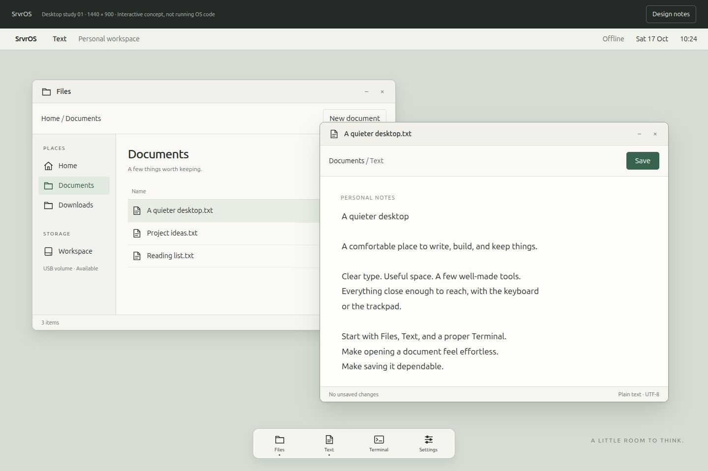

# A MacBook Air desktop for SrvrOS

Status: product direction and implementation plan, 2026-10-17. This supersedes
the earlier GUI roadmaps. The user selected **quiet and refined: warm neutral
surfaces, crisp type, restrained color**.

The primary hardware target is now a useful, pleasant desktop on the
MacBookAir7,2. Server workloads remain supported: a desktop session must coexist
with services, and a headless boot must remain available. The first release is a
small environment for files, text, terminal work, and system controls. A modern
web browser, broad application compatibility, and a full daily-driver OS are
larger subsequent projects.

## Design study

Open [the interactive desktop study](design/desktop-study.html) in a browser.
It is a self-contained visual and interaction prototype, not native SrvrOS code.
Its example files and status values are illustrative; Save retains text only in
the preview's memory. Browser fonts are placeholders for the native text system.

The direction uses warm paper surfaces, a muted sage desktop, dark readable text,
and evergreen selection/action accents. A small launcher and dock expose Files,
Text, Terminal, and Settings. Window controls and application actions have clear
labels, consistent placement, and visible focus. Avoid decorative animation,
translucent layers, and effects that obscure state or consume the rendering budget.

Initial design tokens:

| Property | Working value |
| --- | --- |
| Surface / secondary surface | `#faf9f6` / `#f1f0eb` |
| Text / secondary text | `#292e2b` / `#646b65` |
| Accent / selected background | `#38644f` / `#e0eade` |
| Spacing | 4, 8, 12, 16, 24, 32 logical pixels |
| Body text | 14–16 px at native 1440×900; larger-text option |
| Document text | 17 px starting point; user-adjustable |
| Corners | 5 px controls; 10 px windows |

Native implementation must validate contrast, focus visibility, clipping, and
larger text on the actual panel. Preserve mixed case. Use grayscale antialiasing,
font metrics, and cached glyph atlases; choose and record a redistributable font
and its license before bundling. UTF-8 decoding, fallback glyphs, selection, and
cursor movement need explicit contracts; full international shaping is a separate
scope decision. Do not scale the old 5×7 bitmap alphabet into the new interface.

## What the review found

The accepted console/input/filesystem checkpoint remains the foundation; see
[the hardware acceptance record](input-filesystem-milestone-2026-10-17.md).
That milestone did not validate a new GUI or physical key-to-display latency.

| Existing component | Decision and reason |
| --- | --- |
| Boot, process scheduling, VFS/exFAT, USB storage, keyboard and console | Retain and regression-test. These have recent hardware evidence. |
| `userspace/displayd/displayd.c` | Replace the structure. Its roughly 3,249 lines combine composition, window policy, desktop chrome, launching, key mapping, and test modes. |
| `userspace/lib/src/gui2.c` and `ui.c` | Replace the public toolkit design. Retain useful algorithms only after review; application layout and style should share one system. |
| Old GUI glyph rendering | Replace. `glyph_row()` still folds lowercase into uppercase; the console's improvements did not fix this separate renderer. |
| Existing dirty rectangles | Audit. `ui_render_tree()` can repaint the whole root even when presentation uses smaller damage rectangles. Measure both raster work and framebuffer traffic. |
| `kernel/src/gui.c` and GUI syscall boundary | Audit ownership and lifetime before reuse. `gui_register_server()` currently allows a caller to replace the registered server. |
| Old GUI message ABI | Replace with a versioned protocol. It mixes widget and surface messages and does not provide the complete typed input contract needed here. |
| Existing GUI smoke tests | Preserve behavioral coverage for focus, close, resize, clipping, and client cleanup; adapt them to the replacement. |
| Old app visuals and demo collection | Retire. They impose no compatibility requirement on the new desktop. |

No PTY implementation was found in the reviewed kernel/userspace sources. A real
Terminal therefore needs a pseudoterminal interface and terminal semantics,
including foreground jobs, signals, EOF, resize, and input modes. A shell text
box is not sufficient for that application.

## Hardware evidence and gaps

| Area | Current evidence | Desktop requirement |
| --- | --- | --- |
| Internal keyboard | Working on SrvrOS; USB `05ac:0291`, interface 1 | Preserve modifiers, repeat, case, and responsiveness during I/O. |
| Internal trackpad | Ubuntu binds USB interface 2 to `bcm5974`; SrvrOS raw capture, motion, physical click/drag and resize and two-finger scrolling verified; palm rejection pending | Movement, click, drag, two-finger scroll, palm rejection. |
| Display | Native 1440×900 framebuffer; fast batched console output | Antialiased text, bounded composition, responsive cursor and resize. |
| USB exFAT workspace | Accepted five-round hardware test and clean offline check | Persistent documents, honest save/error state, safe unmount. |
| Laptop controls | Ubuntu exposes battery, AC adapter and lid input | Battery reporting, brightness, idle policy, safe power controls. |
| Networking | Existing e1000/QEMU path; USB adapters pending | Identify actual USB VID/PID/chipset, then select and implement a driver. |
| Audio / suspend / built-in Wi-Fi | No desktop acceptance evidence | Separate later bring-up milestones. |

The old SPI topcase assumption does not apply to the observed keyboard/trackpad
path. Linux's pinned [bcm5974 source](https://raw.githubusercontent.com/torvalds/linux/v6.12/drivers/input/mouse/bcm5974.c)
identifies `0x0291` as Wellspring 8 ISO. Use it as a protocol reference with
appropriate provenance review before importing code. SrvrOS currently chooses a
preferred HID interface; supporting the trackpad must preserve simultaneous
keyboard operation on the same composite USB device.

## Architecture boundaries

| Layer | Owns | Must not absorb |
| --- | --- | --- |
| Kernel mechanisms | Display ownership, bounded surface memory, event delivery, process cleanup, device drivers | Widgets, themes, application menus |
| Userspace compositor | Surface composition, damage, cursor, window placement, focus/capture, decorations | File operations, application business logic, shell command execution |
| Desktop shell | Launcher, running apps, session status and desktop chrome | Device drivers or per-app rendering internals |
| Shared toolkit | Layout, text, controls, focus navigation, menus, dialogs, scrolling, selection, clipboard client | A second window manager |
| Session/laptop services | Settings persistence, clipboard ownership, power/network status, orderly shutdown coordination | Unbounded privileged interfaces exposed to arbitrary apps |
| Applications | Files, Text, Terminal, Settings behavior | Private copies of theme/layout/input rules |

Start with a small protocol and a single test client. Specify key down/up and
modifiers separately from text input; pointer coordinates, wheel units, focus
changes, capture cancellation, and device removal must be unambiguous. Use a
consistent shortcut map: Command/Meta for desktop actions, while preserving
terminal Control combinations such as Ctrl-C. Keyboard-only navigation is part
of the initial contract.

Require exclusive compositor registration, owner-checked surfaces, bounded
queues, and cleanup after client death. Define resize acknowledgement and buffer
lifetimes before implementing shared buffers: an app must not mutate the buffer
currently being presented. Coalesce disposable motion/damage events under load;
do not silently lose key releases or button transitions. Slow clients must not
stall the compositor. A compositor failure must return to a usable console or
recover through a controlled session restart.

Keep software rendering through the existing framebuffer first. Render damaged
regions in RAM and present them in batches; avoid framebuffer reads and per-pixel
syscalls. Make wakeups event-driven and cap continuous redraw. Add GPU acceleration
only if measurements justify its complexity.

## Delivery sequence and acceptance gates

These are ordered milestones, not promises of completed support or dates.

Implementation progress: the [first native foundation slice](desktop-foundation-2026-10-17.md)
adds the renderer, an optional native study, exclusive GUI registration and a
tested trackpad packet decoder. The [compositor/client slice](desktop-compositor-2026-10-17.md)
adds versioned surface ownership, separate applications, resize/focus and crash
recovery, plus opt-in trackpad endpoint capture. D1's complete input contract,
event-driven waits and timing gates remain open. The [physical capture gate](trackpad-capture-2026-10-17.md)
passed with simultaneous keyboard input; D2's pointer/gesture policy and desktop
interaction acceptance remain open. The [first pointer trial](trackpad-pointer-2026-10-17.md)
adds opt-in one-finger motion and physical click/drag. Its first physical trial
passed typing, clicking, dragging and resizing. The subsequent scrolling trial
also passed; palm rejection and the complete input/focus contract remain open.

### D0 — Product and design contract (this change)

Record the hardware evidence, replacement boundaries, design tokens, core app
scope, and interaction study. The study tests the direction cheaply before
native implementation. It does not require a reboot or replace the current boot.

### D1 — A small native graphics foundation

Implement font measurement/rasterization, clipping and damage instrumentation,
then the versioned surface/input contract and a minimal compositor with one
client. Keep app launching and desktop chrome out of this initial core.

Pass gate: native mixed-case antialiased text, moving/resizing one window without
trails, bounded memory use, idle blocking, and client/compositor failure recovery.
Test at 1440×900 plus a smaller QEMU mode. Report raster time, presentation time,
bytes written, and frame latency separately.

### D2 — Built-in trackpad and coherent input

Develop the composite-device trackpad path alongside D1, then integrate it with
focus and pointer capture. Start with one-finger motion, physical click/drag and
two-finger scrolling. Add palm rejection and repeatable gesture behavior before
calling the laptop interaction usable.

Pass gate: keyboard and trackpad work together during file writes and rendering;
focus changes and device recovery leave no stuck keys/buttons. QEMU exercises
event ordering, while physical gesture/feel checks need the user. Synthetic input
cannot substitute for those checks.

### D3 — One consistent desktop and three useful apps

Build only the shared controls required by Files, Text and Settings. Add the
launcher/dock, window switching, resize, clipboard, focus traversal and settings
persistence. Build Terminal on a tested PTY path with the existing shell.

Pass gate: boot, browse the USB workspace, create/edit/save a document, run a shell
job while editing, close/reopen it, and verify its contents after a reboot.
Unsaved-close prompts, full/read-only media, removal and write errors must produce
clear state. Killing a client must not damage other windows or saved files.
Test larger text, keyboard-only navigation, and consistent selection/copy/paste.

### D4 — Make it behave like a laptop

Bring up battery/charger state, brightness controls, display idle and safe
shutdown/reboot. Treat lid behavior explicitly: do not advertise sleep until it
works. Suspend/resume is a separate gate covering timer, USB, display and storage
reinitialization, pending writes, and repeated cycles on the physical machine.

Pass gate: status reflects hardware, settings survive restart, and power actions
flush storage or report a failure. No silent suspension with dirty files.

### D5 — Networked desktop with server capability

Inventory the incoming adapters before choosing a USB network driver. Bring up
link, DHCP, DNS and disconnect/reconnect, followed by existing server regressions
under desktop activity. Expose truthful connection state and actionable errors.
Keep a headless session profile and service startup independent of the GUI.

Native Wi-Fi, audio, accelerated graphics, advanced gestures, and a modern browser
follow as separately scoped work. Network availability alone does not supply a
browser engine, modern TLS, or an application ecosystem.

## Performance and release discipline

Initial targets, not current measurements: normal interactive redraw within a
16.7 ms frame budget and physical input-to-visible response below 50 ms at p95.
Measure sustained scrolling, dragging, resize and typing under filesystem load;
the console's 1,000-line batch benchmark is not a GUI frame-rate measurement.
Track idle CPU use and memory growth as well as throughput. Add longer stress
only after the short deterministic workflow is reliable.

Retain the accepted console/workspace boot and its independent known-good copy.
Build and test the replacement desktop as an opt-in profile. The existing UI is
a historical reference at Git checkpoint `0d91895`, not a design constraint.
Once the new desktop passes its core hardware workflow, remove obsolete UI build
routes and implementations in a dedicated change, retaining useful test cases.
Do not carry two supported widget systems indefinitely.

The immediate implementation slice is **native text/rendering and the minimal
surface contract, with built-in trackpad bring-up**. Files/Text/Terminal follow
those foundations. This avoids spending the next milestone repainting old demos.

The [scrolling/accidental-touch slice](trackpad-scroll-2026-10-17.md) adds an opt-in
gesture profile and a scrollable native study. Initial two-finger scrolling is
physically accepted. A guided follow-up exercised both typing and broad-contact suppression with
general positive feedback; its conservative filter is not yet calibrated palm
rejection. The interactive scrollbar follow-up adds client pointer capture and
page/drag behavior; its initial physical trial passed. The next gate combines
input and focus/capture checks with filesystem activity, followed by measured
latency and device recovery.

The [desktop I/O trial](desktop-io-2026-10-17.md) adds a bounded USB worker,
on-screen focus/capture checks, activity counters and independent final-payload
validation. Its physical acceptance remains pending.
