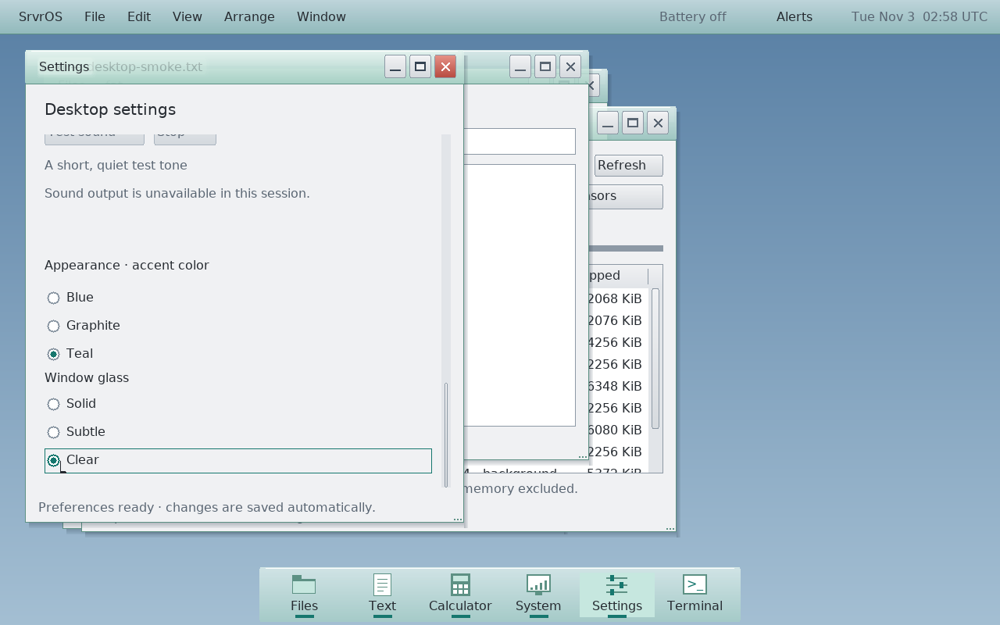
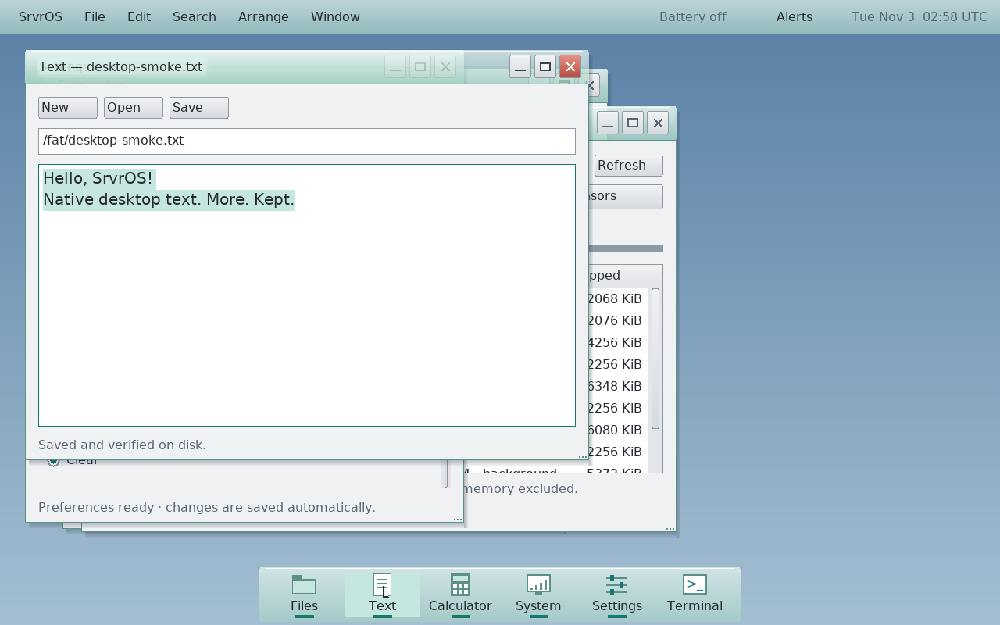
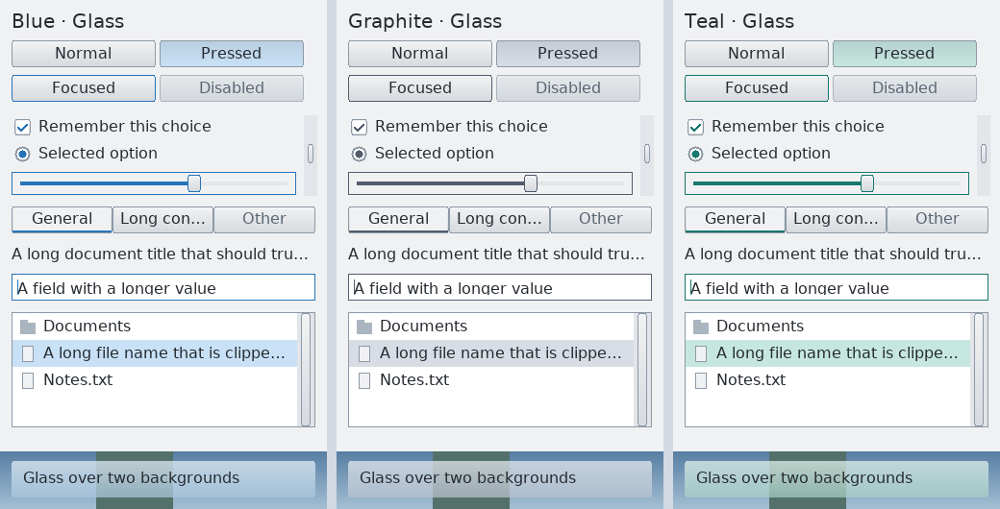

# Global desktop appearance

Settings opens with Appearance: rendered previews select Silver, Aero or Aqua.
Blue, Graphite or Teal accent and Solid, Subtle or Clear glass remain independent
choices. Selection and focus colors follow the accent;
window title bars, menu bar and dock follow the glass treatment. App content stays
opaque. This is tinted transparency, highlights and bounded fading shadows, not
backdrop blur. Solid remains available for predictable contrast.

## Ownership and updates

The compositor owns the authoritative `desk_preferences` snapshot and asynchronous
persistence. A focused Settings window sends masked changes; every accepted change
is broadcast to registered windows, and new windows receive the current snapshot.
Rejected and unchanged requests receive authoritative state too. Settings reports
Applying, Saved, session-only or conflict status rather than claiming a successful
save when transport or storage failed. Its appearance confirmation has a bounded
timeout; retry remains explicit.

Protocol v18 adds confirmed display requests and authoritative display state
inside the unchanged 168-byte desktop packet. Build matched compositor and GUI
applications; no mixed-version compatibility is claimed. The strict v7 preference
file uses a 512-byte bound and reads v1–v6. Older files default to inherited
resolution and 1× scale; pre-v6 files use Silver, and pre-v5 files use Blue/Subtle.
Display scale/resolution use a separate Apply/Keep/Revert transaction. Generic
appearance preference updates cannot bypass its confirmation or overwrite those
fields. Only Keep persists a trial; startup restoration retains rollback state
until clients have accepted their new sizes and density.
The existing delayed-load merge, debounce, verified write, conflict and shutdown
rules remain in the OS runtime.

Each `desk_app` caches a validated, server-authenticated preference snapshot.
Visual changes dirty that window. The inline `desk_app_theme()` adapter resolves
a caller-owned theme through SrvrUI's `desk_theme_configure_style()`; no mutable theme
global or OS calls enter the widget library. App main windows and owned dialogs
resolve their own snapshots. Theme changes do not rewrite image, paint or terminal
content colors. Compact control fonts retain their established size; the existing
document text-size behavior remains app-owned. Appearance updates avoid relayout
and preserve selection, scroll position and pointer capture.

The first engine exposes bounded presets. Future properties should extend this
same validated snapshot/resolver path, with a protocol/file migration when the
wire or saved representation changes. Avoid new per-app preference stores.

## Complete style profiles

Silver retains the original appearance and is the migration/default style. Aero
adds cool glass, a split highlight on beveled controls, richer selection, inset
fields and stronger scrollbar thumbs. Aqua uses neutral silver chrome, softer
rounded controls, colored window-control indicators and centered window titles.
All three retain the same control geometry, window-button order, font metrics,
keyboard navigation and content layout. Disabled, focused, pressed and selected
states share the same profile resolver. The previews draw actual toolkit pixels.

These are original adaptations informed by Microsoft's
[Windows 7 design guide](https://learn.microsoft.com/en-us/windows/win32/uxguide/guidelines)
and Apple's [Yosemite design announcement](https://www.apple.com/newsroom/2014/10/16OS-X-Yosemite-Available-Today-as-a-Free-Upgrade/).
They use the existing bounded renderer; no backdrop-blur pass or animation loop
is introduced. `desk_theme_configure()` remains a Silver-compatible wrapper for
existing toolkit callers.

## Composition and verification

### Profile acceptance — November 3, 2026

Clean runtime `50389359`, SrvrUI `89fb6d9` and SrvrApps `d245fe2` pass the matched
full build and final profile VM. The complete desktop/widget host suite covers
migration, style-only updates, clipping, padded strides, and exact partial/full
redraw equality during drag and scroll. The existing Settings and application
workflow VMs pass; the final focused Settings host run covers its compact fix.
Both profiles update existing/new Text windows, dialogs and menus without losing
selection/content. Aqua restores after desktop restart. Actual 280×240 and
larger-text Settings renders were inspected alongside the full desktop.

Fifteen alternating samples per style measured median host frame paint costs of
334/334/283 µs for Silver/Aero/Aqua, title-damage costs of 121/121/70 µs, and cursor
costs of 4/4/4 µs. This supports bounded renderer cost; host vblank and native
hardware acceptance are not established by this comparison.

See the [acceptance receipt](assets/screenshots/theme-profiles-manifest.json),
[widget specimen](assets/screenshots/theme-profiles-widgets.png),
[Aero desktop](assets/screenshots/theme-profiles-aero.png), and
[Aqua desktop](assets/screenshots/theme-profiles-aqua.png).

The glass primitive blends only the current destination pixel, with coordinates
anchored to the original rectangle and bounded rounded spans. It preserves incoming
clips and padded strides. No neighboring pixel read makes partial damage depend
on tile order. Translucent chrome and shadows never count as opaque occluders;
only a higher window's opaque body can suppress covered client pixel copies and
opaque body fills. Fully hidden windows may be skipped only when their entire
paint bounds fall inside that higher opaque body.

`test-widget-theme` and the scene, overdraw and session fixtures under
`test-desktop` cover blending, clipping, all glass levels, snapshot rejection and redraw.
The complete desktop/widget/I/O suite is the integration gate. The application VM
checks a selected Text row before and after a live accent change, a new window,
verified saved config and a new desktop process loading that config. The Settings
VM retains existing clock, wallpaper, pointer and persistence coverage.

Use `make widget-theme-preview` for real control-state specimens. Runtime screenshots
show appearance, but cannot prove physical scanout is tear-free; see the
[presentation investigation and driver plan](display-presentation.md).

Glass has a CPU cost in the software compositor. The macOS/Rosetta 128-window
stacked full-scene fixture measured 5,516,676 writes and a roughly 8.8 ms median
with occlusion, versus 23,684,280 writes and roughly 16.4 ms without it. The prior
opaque renderer was roughly 0.12 ms in that fixture because it could discard
whole covered windows. These are stress-fixture host numbers, not native input
latency or a guarantee of frame rate. Caching or accelerated composition is a
separate performance direction; correctness requires retaining visible glass
layers. Ordinary application workflows are checked in QEMU.

## Verified result — November 2, 2026

Runtime `db898927`; SrvrUI `df2e311`, SrvrApps `e4b9235`, SrvrPorts `0494ae2`.
Full matched build, desktop/widget/I/O host suites, theme ASan/UBSan and final
application/compositor VMs pass. The separate Settings VM passed before the last
title-frost-only adjustment. The host scene test includes preserved-buffer drag
and lower-window content changes under glass, not only static tiled rendering.
The live application check proves existing and new window selection colors and
saved appearance reload. All disposable VMs stopped; native scanout is unverified.

[Image hashes and source revisions](assets/screenshots/glass-manifest.json).
