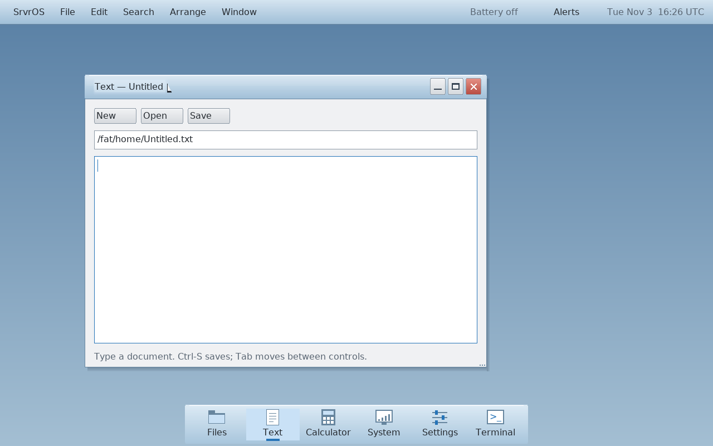

# Desktop presentation and scanout

The desktop keeps a software canvas in RAM. A client commits a sealed surface;
the compositor copies it into a private window cache before replacing the
previous image. The protocol's release acknowledges this snapshot, not physical
scanout (`shared/include/srvros/desktop_protocol.h`). The compositor freezes the
scene and stacking order for each damage batch, composes every damaged rectangle
into the canvas, then submits those rectangles to the framebuffer. This reduces
the time spent rendering between uploads of related damage; it does not make
those uploads atomic.

The graphics syscall copies each rectangle from userspace in bounded chunks of
at most 64 KiB and checkpoints service work (`kernel/src/arch/x86_64/syscall.c`).
The console blitter writes rows directly into the inherited framebuffer
(`kernel/src/console.c`). Separate rectangles and chunks can become visible at
different times, and scanout can overlap a write. Either can contribute to a
visible discontinuity during movement or scrolling; the actual observed artifact
has not yet been isolated. There is no vblank-synchronized page flip in this
path. A second software canvas or a full-frame copy alone cannot guarantee a
tear-free display.

The existing Intel graphics code identifies the controller and maps resources;
it does not establish display ownership or implement scanout flips. The Air6,1
unit record documents the incomplete Haswell display-resource handoff. Preserve
its active diagnostic ownership and model-specific gates; do not infer that a
related model has the same firmware routes or safe registers.

## Verification and next stages

1. Compare damage coverage, tiled/full pixels, upload order, and failure behavior
   in host tests; run the desktop compositor and application VM checks. Measure
   copy time, frame/input latency, and framebuffer bytes on identical workloads.
   Retain the bounded kernel copy/checkpoint behavior.
2. Capture repeated drag and scroll observations on each target with an external
   camera or other scanout-aware instrument, alongside software timing. A
   screenshot of the completed framebuffer cannot establish whether a physical
   scanout tear occurred. QEMU results do not establish physical behavior.
3. For each target, establish controller, active pipe/plane, framebuffer format,
   inherited firmware state, display power dependencies, and a safe recovery and
   ownership handoff using model-specific evidence. Coordinate the existing
   display audit before touching controller registers. Unsupported devices retain
   the inherited framebuffer path.
4. Only after ownership and memory lifetime are validated, design scanout-capable
   front/back buffers, a bounded vblank-synchronized flip and completion event,
   and fallback/recovery for unavailable interrupts, timeouts and mode changes.
   Hold a scanout buffer until the display has stopped using it. Verify the
   transition and teardown in a suitable emulator and on each authorized target.
   The [Linux DRM KMS documentation](https://docs.kernel.org/gpu/drm-kms.html)
   describes modesetting, framebuffer, plane, vblank and atomic-state concepts;
   it is a reference for the contract, not proof of SrvrOS hardware support.


## QEMU transport foundation — November 3, 2026

The first checkpoint is an opt-in boot-time transport probe on a separate
modern `virtio-gpu-pci` device. Standard VGA remains the inherited display owner.
This diagnostic does not change scanout or physical Intel ownership. Its
acceptance sequence is device/capability validation,
inactive-state proof, split-queue feature negotiation, fenced `GET_DISPLAY_INFO`,
validated completion, reset confirmation, DMA retirement and console recovery.

A plain Bochs/VBE Y offset switch is not the selected foundation. QEMU's
[pinned VGA source](https://github.com/qemu/qemu/blob/v11.1.0/hw/display/vga.c#L1628)
can share native-format surfaces directly from video memory; its shadow-copy path
is conditional. Reading the offset back proves register state, not retirement of
an old display surface. A fixed delay is not a completion fence. This is a source
finding, not a measured explanation of the user's visible artifact.

The [VirtIO 1.2 GPU contract](https://docs.oasis-open.org/virtio/virtio/v1.2/virtio-v1.2.html)
provides fenced command-processing completion and a sequence for separate resources,
transfers, scanout selection and flush. This is a stronger resource-management
foundation, but its fence still does not mean Cocoa finished drawing or a physical
monitor reached vblank. Do not advertise it as end-to-end tear-free output.

The probe requires an exact inherited standard VGA framebuffer base and a unique
modern non-VGA VirtIO GPU. PCI configuration access must establish status zero
before target BAR sizing or ownership. It runs once, immediately after PCI
initialization, with kernel CR3 active; temporary mappings belong only to that
address space. This deliberately avoids the existing kernel mapping registry's
capacity/retirement limitation. DMA allocations are freed only after a confirmed
device reset; a failed reset retains them and reports failure. Foreign-owned,
unsupported and malformed devices are refused. Normal boot never runs the probe.

Reproduction, once the matched image is built:

```sh
TMPDIR=/tmp python3 tools/virtio_gpu_probe_smoke.py
```

The harness explicitly selects standard VGA plus the secondary device and tests
opt-in success, absent-device refusal and opt-out behavior in sequential disposable
VMs. Each case verifies a post-probe shell command and captures the surviving
framebuffer. Native-device results remain outside this milestone.


## Opt-in primary VirtIO presentation

The QEMU-first choice extends that transport to primary `virtio-vga`. Boot token
`srvros.virtio-gpu=present` enables read-only admission; ordinary boot and native
Intel displays retain the inherited path. The desktop claims presentation only
when it owns both GUI server registration and console mute. Graphics capability
bit `0x10` advertises the backend. Additive syscalls 156/157/158 acquire, present
and release; matched userspace wrappers are `gfx_present_begin`, `gfx_present`
and `gfx_present_end`.

Existing bounded graphics uploads still build the inherited VGA framebuffer as
a staging image. Once every dirty region has been composed and uploaded, the
desktop submits one frame. The driver copies into the inactive resource's backing,
fences its transfer, selects that completed resource for scanout and fences its
flush. It alternates two resources, never updating the current scanout resource.
There are no per-frame allocations or mapping-registry entries. This first path
copies the complete frame, so it favors a clear ownership contract over partial
transfer optimization.

Copy/zero work checkpoints at most every 64 KiB; command waits periodically
checkpoint with finite clock/count limits. The existing scheduler I/O gate keeps
DMA lifetime protected, restoring the caller's address space at every checkpoint.
Reentrant presentation and staging writes are rejected while submission is busy.
Reset must finish before backing memory is freed. A verified reset restores
QEMU's VGA mode; uncertain retirement quarantines allocations and refuses further
presentation or framebuffer ownership. Normal exit and process death share the
same release hook. QEMU's [VirtIO base reset](https://github.com/qemu/qemu/blob/v11.1.0/hw/display/virtio-gpu-base.c)
and [VGA wrapper](https://github.com/qemu/qemu/blob/v11.1.0/hw/display/virtio-vga.c)
provide the emulator-specific recovery behavior; this is not a portable native
GPU recovery claim.

```sh
sh tools/macos/build.sh -j2 all
TMPDIR=/tmp python3 tools/virtio_gpu_present_smoke.py
python3 tools/macos/run.py --display-device virtio
```

The launcher defaults to standard VGA. The new backend guarantees the implemented
VirtIO command ordering, not host compositor vblank or physical tear-free output.
The current supported mode is the inherited 32-bit BGRX resolution; live resizing,
native acceleration and adaptive refresh are outside this milestone.


### Verified checkpoint

Runtime `a8c21344367883edd07f5ee051caa9edc6cd8308` passes the matched build and
QEMU 11.1.2 checks on the Apple Silicon build host. The final primary run rendered
16 frames through the visible drag session, 4 through deterministic scrolling,
and 2 after kill/reacquisition. Console output was visually inspected after the
forced owner exit. Separate probe boots pass enabled, absent and disabled cases;
the absent-device case also renders/exits the ordinary VGA desktop.

The driver/lease fixtures cover malformed PCI/completion state, resource order,
inactive backing, queue slot reuse/index wrap, partial allocation, timeout,
reset-before-free, quarantine, restart, CR3/service checkpoints and ownership
exclusion. PCI, console, graphics copy/service, I/O scheduler, syscall cancellation
and full desktop/widget host suites pass; driver and lease ASan/UBSan pass. Focused
checks were rerun after the final partial-copy checkpoint and immediate poison
corrections. Documentation links and whitespace checks pass. This is emulator
acceptance of the named cases, not physical tearing or audio-latency acceptance.

[PR281](https://github.com/PaulMDemers/SrvrOS/pull/281) was merged into `main`
after PR280 on November 3. Post-merge runtime `1c0896e7` has the identical tree
and passes the matched build and primary presentation/recovery VM again.
The [manifest](assets/screenshots/virtio-manifest.json) records clean runtime
source, kernel/image hashes and screenshot hash. Raw receipts remain in ignored
`build/review/virtio-gpu-probe/` and `build/review/virtio-gpu-present/`. All test
VMs were stopped; no native boot or Actions run occurred.




## Visible smoothness comparison — November 3, 2026

The attended Cocoa comparison favors VirtIO for window dragging. The user
reported “Smooth, with no obvious tearing” with VirtIO, then “VGA is visibly
worse” with standard VGA at the same 1440×900 resolution. This is the user's
bounded visual observation, not an instrumented physical-vblank guarantee.

Six sequential automated runs (three per backend, alternating order) then used
identical Q35, QEMU 11.1.2, single-thread TCG with 256 MiB translation cache,
qemu64/one CPU, 1024 MiB RAM, Cocoa and 1440×900/scale 1 settings. Each fresh
Help session receives 450 relative movements at 60 Hz: five 300-pixel horizontal
window-drag legs or five 120-pixel vertical scrollbar-thumb legs. Every run proves
a 300-pixel window displacement, positive/reversing document offsets, successful
frames and normal exit. VirtIO acquisition/release is required for its runs.
All six pass. The final scroll images match byte-for-byte below the menu bar.

Median of the three per-run means, in milliseconds:

| Software interval | VGA drag | VirtIO drag | VGA scroll | VirtIO scroll |
| --- | ---: | ---: | ---: | ---: |
| Compose, upload and final presentation | 7.953 | 14.354 | 6.995 | 16.619 |
| Consumed pointer event to final presentation | 7.959 | 14.192 | 6.704 | 16.500 |
| Consecutive motion-bearing poll gap | 11.181 | 20.049 | 14.446 | 23.184 |

Per-run frame-work means were tightly grouped: VGA drag 7.938–7.970 ms,
VirtIO drag 14.173–14.358 ms, VGA scroll 6.964–7.082 ms, and VirtIO scroll
16.588–16.621 ms. Maximum host injection lateness ranged from 3.829 to
5.021 ms across sessions. These are descriptive repeats, not statistical proof.

The existing `--hardware-trial` software timers use a fixed-one-tick wait policy.
Statistics cover the entire session, including initial settling, cursor positioning,
post-workload wait and menu exit; poll gaps include idle. Counts are successful
frame/event batches, not one sample per injected event. The VirtIO interval
includes fenced presentation. None measures pre-poll input queue residence or
Cocoa/monitor scanout; histogram percentile values are upper bounds, not exact
quantiles. The scrollbar workload is intentional: the current QEMU PS/2 and USB
mouse paths do not deliver wheel deltas to the desktop. No input-driver changes
were made for this comparison.

Conclusion: the observed visual improvement is accompanied by higher guest-side
cost and slower motion-bearing poll cadence. The full-frame copy/transfer is a
candidate for later optimization while preserving complete-frame publication and
buffer lifetime. It is not a blocker to using the opt-in VirtIO backend now.
Standard VGA remains the launcher default; this comparison does not change native
hardware acceptance or assert end-to-end tear-free output.

Reproduce with `TMPDIR=/tmp python3 tools/display_smoothness_compare.py --display cocoa --repeats 3`.
The [compact result manifest](assets/screenshots/smoothness-manifest.json) contains
per-run means, bounds/counts, input lateness, attended observations and hashes.
The runtime matches merged `bfb6d2a7`; its kernel/exFAT hashes match the accepted
merged image. The working tree was dirty only for measurement tooling and the
scope record, not kernel/userspace changes; the executed harness and initramfs
are separately hashed. Raw inputs, screenshots and serial logs are local under
`build/review/display-smoothness/cocoa/`. All automated VMs were stopped.
