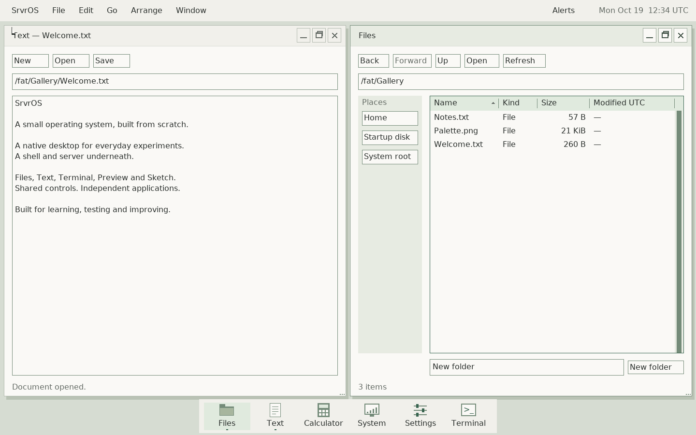

# Native desktop guide

This is the current `deskd` desktop, implemented with the shared native widget
library. The older `gui`/`displayd` applications and the browser design study are
historical prototypes. Start the current desktop from the SrvrOS monitor:

```text
run /fat/bin/deskd
```

Automated evidence is from disposable QEMU VMs, with repeated physical trials
on Air7,2. The latest interactive v22 trial accepted desktop boot, brightness/volume changes
and live sensor display. Physical two-finger pressing now selects secondary click at press;
specific gesture cases still need confirmation. Secondary tapping is separate.
The October 19 interactive round reported generally good behavior and recorded
no recurrence of the earlier System input-timeout closure. That earlier cause
is not conclusively established. The Terminal backspace correction passed its subsequent hardware
retest, alongside explicit Text Ctrl+C/V/A validation. Host regressions now cover input and control
packet delivery deadlines; clients get a delivery attempt before queued time is
blamed on them, and genuinely unresponsive clients still have bounded cleanup.
See the [machine record](machines/macbookair7-2.md) for precise
acceptance and the [development journal](desktop-progress-2026-10-19.md) for history.
New machine agents should follow the [Ubuntu setup guide](ubuntu-device-agent-setup.md).



[Current gallery and capture provenance](screenshots.md). Later unattended native
captures measured idle behavior and diagnostics; they do not replace interactive
acceptance of new input changes.

## Display scale

The default remains 1× on every machine. An explicit integer scale can be selected
when starting the desktop:

```text
run /fat/bin/deskd --scale=2
```

At a 2880×1800 boot framebuffer this gives a 1440×900 logical desktop. Windows,
controls, pointer movement, hit testing and damage use logical pixels; the final
copy expands each pixel to a 2×2 block. Client surfaces and the eight-window
cache allocation stay the same size. This is integer enlargement of the existing
raster toolkit, not new higher-resolution font rendering or GPU acceleration.
The mode requires at least 640×480 logical pixels; other scales are rejected.
`--scale=1` selects the existing behavior. It can accompany `--apps-trace` or a
trial mode. There is no automatic DPI inference or persistent scale setting yet.

Saved screenshots contain the logical canvas (1440×900 at the example mode),
including its cursor. Expanding that BMP by 2× reproduces the displayed pixels.
This keeps captures within Preview's current 8 MiB file limit. Serial diagnostics
record physical dimensions, logical dimensions and scale. VM evidence does not
accept the firmware-selected display or GPU on an additional physical Mac.

The unattended `--idle-capture` mode is reserved for the v25/v26 hardware diagnostic
profiles. It uses the prepared USB workspace, samples 60 seconds after startup,
saves a screenshot and exits. Normal launches and the interactive hardware trial
retain their existing manual exit behavior. See the [device-agent guide](ubuntu-device-agent-setup.md).

## Desktop controls

The top bar contains the SrvrOS menu, the focused application's menus, Arrange,
Window, and the clock. The dock opens or focuses common apps. Command means the
Mac keyboard's Command key, or the Meta/Windows key in a VM.

| Action | Shortcut or control |
| --- | --- |
| Find an app or existing window | Command-Space; type a name and press Enter |
| Search file names | Command-Shift-F |
| Cycle windows | Alt-Tab / Alt-Shift-Tab |
| Navigate menus | F10, arrows, Enter, Escape |
| Tile left / right | Command-Alt-Left / Right |
| Center at the original normal size | Command-Alt-Up |
| Maximize / restore original geometry | Command-Alt-Down |
| Save a screenshot | Command-Shift-3 |
| Open Alerts | Command-Shift-N |
| Open contextual Help | F1 |
| Contextual actions | Right-click, Control-click, or Shift-F10 in supported controls |
| Close the active app | Command-W; apps guard unsaved work |
| Return to the monitor | SrvrOS → Return to console |

The launcher lists open windows as well as app launch entries. Select an existing
window to resume it; choose the app entry to open another instance. Eight client
windows can be open at once. A full desktop asks you to close a window before
opening another app. The [eight-window menu](assets/screenshots/native-desktop-window-menu.png)
shows the desktop at its current client limit.

This is a software capacity limit, not a MacBook hardware limit. The compositor
reserves eight client slots and two maximum-size 1440×900 pixel caches per slot:
about 79 MiB for those caches alone. The kernel separately bounds GUI queues to
16 and surfaces to 32. Raising only the client constant would increase the
up-front memory cost and eventually hit those other limits. The intended next
step is demand-sized window buffers, coordinated queue/surface capacity and
graceful allocation failure under memory pressure; this device milestone keeps
the existing limit.

A capacity follow-up should first allocate caches for live windows at their
actual size, while retaining the old front buffer until a replacement frame is
complete. Failed growth must leave the displayed frame and input ownership
intact. Then coordinate client slots, GUI queues/surfaces and process resources
under a memory budget. Validate opening beyond eight windows, repeated maximize/
restore, close/reopen and allocation failure without leaks or lost input before
raising the advertised limit. There will still be a resource ceiling, but it
should be an intentional policy rather than eight preallocated full-screen pairs.

Tile left/right retain the original frame across side switches. Center returns
to the original normal dimensions at the middle of the workspace. Restore size
returns to the original position as well. Tiled windows must be restored or
centered before free dragging/resizing. Narrow screens disable tiling when two
minimum-size clients would not fit.

The clock opens a month calendar with Today and keyboard navigation. Alerts
retain the current session's notifications. Timer and screenshot banners do not
steal keyboard focus. Screenshots include the pointer and are saved as verified
BMP files under the session Home’s `Screenshots` folder; the completion banner opens it.
Home is `/fat/home` normally and `/work/srvros-work` for the prepared USB laptop trial.

## Applications

| Application | Current useful workflows |
| --- | --- |
| Files | Places and location browsing; Back/Forward; sortable details; create folders; open, rename, duplicate, inspect, or permanently delete selected items |
| Text | Open/edit/save UTF-8 text; selection and clipboard; Find/Replace and Replace All; multi-step undo/redo; draggable horizontal and vertical scrollbars |
| Terminal | A real PTY-backed shell; scrollback, selection/copy, foreground signals, resize, and independent sessions |
| Preview | Open PNG/JPEG/BMP; fit, zoom and pan; open the image in Sketch |
| Sketch | Pen, Line and Box tools; brush size and RGB color panel; undo/redo; import images and save verified BMP copies |
| Find Files | Background name search under a folder; kind filters; sortable results; open, reveal in Files, and copy paths |
| Calculator | Expressions, parentheses, keypad, explicit errors, copied results and calculation history |
| System | Live process and memory information; network interface, address, link state, speed and duplex; open diagnostics |
| Network Utility | Background Ping and DNS lookup; Stop; copied reports |
| Settings | Persisted desktop color, document text size, clock display/UTC offset and trackpad speed/acceleration |
| Clock | Countdown and stopwatch; pause/resume, laps and copied times; completion notification |
| Help | Offline topics, topic search, Back/Forward, keyboard navigation and copied pages |

App menus display the relevant shortcuts. Text uses Ctrl-O/S/F/H for Open, Save,
Find and Replace; Files uses Ctrl-L for location, Ctrl-F to search the current
folder and Ctrl-I for item information. Terminal reserves Control keys for the
foreground program: Ctrl-C interrupts it, Ctrl-Shift-C/V copy/paste, and
Shift-PageUp/PageDown scroll. A shell that exits leaves its terminal output
visible until the window closes.

## Documents and background work

Files and Text use a persistent worker with bounded nonblocking communication.
Save operates on a snapshot, verifies stored bytes, and leaves later edits dirty.
External file changes and name collisions produce explicit errors rather than
silently overwriting a conflicting file. Normal window close allows
Save/Discard/Cancel where appropriate. Normal desktop exit waits for accepted
background saves; Ctrl-Alt-Escape is an emergency exit, not a save operation.

Open/Save pickers and folder fields normalize absolute paths consistently:
repeated slashes and `.` collapse, and `..` stops at root. This is lexical path
normalization, not symbolic-link resolution. Operations target the mounted VFS;
the desktop does not yet offer a removable-volume manager or automatic mounting.

## Trackpad and saved preferences

Settings offers five trackpad speed levels and an acceleration toggle. Slow
movement retains precision; fast swipes gain more travel. Two-finger scrolling
is independent. This policy currently applies to the Apple trackpad path, not
generic mice. The default desktop starts at speed 3 with acceleration on;
console/legacy trial input retains fixed scaling. The final feel awaits the
next MacBook Air trial.

A malformed trackpad report, endpoint failure or palm suppression during a held
press now cancels that interaction instead of sending an ordinary release that
could activate a widget. Cancellation discards uncertain queued pointer actions,
preserves an external mouse's held-button state, and requires a fresh trackpad
release before another physical press. The compositor preserves queued text and
keys while delivering cancellation ahead of subsequent pointer input. These
fault paths have host coverage; physical acceptance remains pending.

The prepared laptop trial saves preferences in
`/work/srvros-work/desktop.conf` using the existing verified background writer.
Normal desktop sessions use `/fat/home/desktop.conf`; if `/fat` is RAM-backed,
those settings last only until reboot. Settings reports save errors and external
file conflicts. Existing v1 and v2 preference files load with typing suppression
off and migrate to v3 on the next successful change. v1 also receives default
speed and acceleration values. Save verification does not
provide power-loss atomicity.

## Deliberate current limits

- Text documents and clipboard payloads are bounded to 64 KiB. Text keeps at
  most 256 undo records within its history arena. Editing is Unicode-codepoint
  based; shaping, grapheme clusters, IME and complete keyboard layouts are open.
- Files duplicates individual files up to 16 MiB. Directory deletion requires
  an empty directory; there is no recursive copy, Trash or undo for file deletion.
- File lists and search results retain at most 256 entries and report limits.
  Actionable paths are at most 159 bytes. Find Files searches names, with ASCII
  case folding; it is not content indexing or a symlink-aware search service.
- Preview accepts files up to 8 MiB, dimensions up to 4096 and four million
  pixels. EXIF orientation, color management and animated images are not yet
  implemented. Sketch is a small bitmap editor with four undo steps, not a
  layered graphics application.
- Terminal implements a bounded ANSI/VT subset. Resizing does not reflow saved
  lines; combining and double-width glyph semantics remain open.
- Notification history and calculator/stopwatch history belong to the session.
  Windows and unsaved documents are not restored after reboot.
- Network Utility uses the existing network stack with boot-selected e1000 or
  opt-in [USB CDC ECM](usb-network-2026-10-18.md). Other USB Ethernet chipsets,
  Wi-Fi, live failover and re-enumeration remain open.
- Settings has target-specific brightness and initial HDA sound controls; System
  has Devices and Sensors tabs. [Audio](macbook-air-audio-2026-10-18.md) and
  [temperature reporting](macbook-air-sensors-2026-10-18.md) need physical
  acceptance. Battery/AC, fan control, safe suspend and removable-device recovery
  remain separate hardware work.
- Save verification is not power-loss atomicity. The generated test-image format
  also has existing external exFAT-conformance limits, recorded in the journal;
  the accepted hardware flash filesystem was not changed by this session.

## Developing and testing

Start with the [widget library guide](../userspace/widgets/README.md), which maps
shared controls, pure models, event routing and client-runtime services. Apps
should extend that library rather than copy a control implementation. The
[desktop architecture plan](desktop-plan-2026-10-17.md) describes the ownership
boundaries; the journal records their implementation in order.

```sh
tools/host-env.sh make -j2 all
make -j2 test-core test-desktop
tools/host-env.sh python3 tools/desktop_arrange_smoke.py --resolution 1440x900
tools/host-env.sh python3 tools/desktop_arrange_smoke.py --small
tools/host-env.sh python3 tools/desktop_lifecycle_soak.py --rounds 6
tools/host-env.sh python3 tools/desktop_capacity_smoke.py
tools/host-env.sh python3 tools/desktop_recovery_smoke.py
```

Each VM script copies the filesystem image before mutating it. Evidence lives
under `build/review/`; these commands neither reboot the laptop nor install a
hardware boot image. App-specific `tools/desktop_*_smoke.py` workflows exercise
saved file bytes, clipboard, controls and worker behavior beyond the lifecycle
checks. Read a script's options before using it as a targeted regression.

The next laptop-service work is grounded in a
[read-only battery/backlight inventory](macbook-air-laptop-services-2026-10-18.md),
including the observed ACPI SBS path and hardware acceptance order.

## Opt-in laptop acceptance trial

The UUID examples below belong to the reference Air. On another machine use
its own prepared USB UUID. Current staging produces v22 and omits the optional
AML probe after its native stall. Audio and sensors remain device-gated; a
desktop boot does not imply all providers support the machine.

`python3 tools/hardware_boot.py stage --desktop-volume 37d8c5d0` stages the
interactive trial for the prepared USB workspace on this laptop. It enables
Apple trackpad gestures, keeps AHCI disabled and `/fat` in RAM, and opens Help
at **Laptop trial**. No automatic pass is inferred and there is no timed exit
or automatic reboot. The normal boot profiles remain unchanged.

The checklist covers window controls, typing/clipboard, persistent USB document
save/reopen, Terminal output, the new apps and screenshots. The prepared volume
must mount successfully before the desktop starts. Return to console closes the
session and attempts to flush/unmount `/work`; the console reports the result and
waits. Type `reboot` only after `USB unmounted=yes`. Errors remain visible.

Before installing a trial, preserve the accepted hardware release. Use
`install --release RELEASE --keep-previous` when the existing previous entry is
the accepted recovery to retain; the installer verifies it before making changes.
Rehearse the trial’s
exact staged loader/kernel/initramfs with:

```sh
tools/host-env.sh python3 tools/hardware_boot_smoke.py --desktop-check
```

This creates a disposable USB workspace with the stage's UUID, boots through
UEFI GRUB and Limine, checks the initial Help page, saves mixed-case text through
the GUI using its default USB path, saves a screenshot and Terminal working-directory
evidence, exits and unmounts, and independently checks file contents and exFAT
consistency. A second fresh VM checks saved preferences and documents, separate
log sessions and another clean unmount. It does not validate the physical Apple input path.


### Persistent trial workspace and diagnostics

In the laptop trial, Files Home, the document pickers, Text's new-document path,
Terminal's initial directory, preferences and screenshots use `/work/srvros-work`.
Normal sessions retain `/fat/home`. Applications receive the session location
explicitly; choosing a default directory does not perform filesystem I/O from
the compositor event loop.

Every laptop trial creates a fresh `Logs/session-<timestamp>-<suffix>` directory
on the prepared USB volume. `boot.log` saves the initial console tail. Changed
logs are checkpointed about every ten seconds into alternating `session-a.log`
and `session-b.log`; `exit.log` is saved before the final flush/unmount. Each file
contains at most the latest 64 KiB, with a timestamp and byte counter in its
snapshot marker. This is bounded diagnostic history, not a complete transcript.
Writes are read back and flushed through the existing storage service gate.
A failed save is visible and stops periodic retries; the previous checkpoint
remains available. A sudden reset can lose recent messages and these writes do
not provide power-loss atomicity. Photograph a frozen screen when possible.

The compositor now records close requests, child exit statuses and forced-close
reasons. Release identity and read-only laptop-service preflight readings are
included in the boot snapshot. The preflight checks the captured firmware and
chipset identity before reading status/backlight registers; it does not write
EC commands, change ACPI mode or alter brightness.

After returning to Ubuntu, collect without modifying the USB source:

```sh
python3 tools/hardware_desktop.py --uuid 37d8c5d0
```

The collector verifies the prepared volume marker, copies bounded log files into
`build/desktop-collections/`, checks the copies and records hashes and attention
markers in `collection.json`. Missing exit logs and recorded failures remain
visible. A collection is evidence for review, never an automatic hardware pass.


### Unattended laptop-service capture

For diagnostics that do not need physical input, stage a separate profile:

```sh
python3 tools/hardware_boot.py stage --laptop-probe-volume 37d8c5d0
tools/host-env.sh python3 tools/hardware_boot_smoke.py --probe-check
tools/host-env.sh python3 tools/hardware_boot_smoke.py --probe-check --probe-missing-workspace
```

The v19 profile runs the same read-only laptop preflight, mounts the prepared USB
workspace, saves boot/exit snapshots with release identity, flushes and unmounts,
then requests a normal reboot. It opens no desktop and does not test physical
keyboard/trackpad behavior. Missing workspace, failed logging, failed unmount or
failed reboot halts on a visible error, without a countdown. Install the exact
verified release with `--keep-previous`, then select it once using `grub-reboot`;
Ubuntu remains the default. Collect its session logs with `hardware_desktop.py`
after Ubuntu returns. A saved capture is not desktop hardware acceptance.


### Brightness bring-up

The v20 interactive laptop profile enables the brightness provider after the
same exact firmware/resource and PCI checks used by the read-only preflight.
Startup only reads registers. Settings adds a shared slider below Trackpad with
a 5–100% range; opening Settings also only queries the provider. Other hardware
shows unavailable. Changes apply to this session and are not loaded from the
preferences file or changed automatically at startup.

The initial backend supports the observed PCH override mode, period 2777 and
disabled CPU PWM only. It changes the duty field, preserves the upper period
bits, writes no control/enable/polarity register, and checks readback. A changed
mode/period, invalid duty or failed readback makes the provider unavailable until
reinitialization. There are no waits, allocations or filesystem accesses in the
brightness syscall. Only the registered compositor can call it; the compositor
accepts changes only from focused Settings. Query responses and failed requests
never overwrite unrelated desktop preferences. Physical brightness acceptance
still requires the laptop: compare 20%, 50% and a comfortable final setting while
typing and moving the pointer, then confirm clean USB flush/unmount on exit.


### Window size limits

Maximize fills the usable 1440x900 laptop desktop, leaving the menu bar, dock and
eight-pixel side margins visible. Clicking again restores the original window
position and size. Preview's Fit/1:1 controls affect the image inside that window
independently. Shared client surfaces are capped at 1440x900; the kernel pixel
budget derives from the same constants. Larger screens still respect that cap.
Compositor caches remain preallocated, so resizing adds no cache allocations.

All standard desktop windows draw the same three outlined titlebar buttons:
minimize, maximize/restore and close, from left to right. Their visibility depends
on desktop mode, not an application catalog ID. Drawing and hit testing share
the control rectangles. Window > Maximize (or Restore size) exposes the same
action for the active app.

### Typing and trackpad movement

Settings → Trackpad → Disable while typing is off by default, including when
loading older preference files. Switching it on opts into the existing built-in
keyboard suppression policy: ordinary typing starts a 300 ms quiet interval,
held typing keys extend it, and incidental contacts stay suppressed until lift.
Physical clicks and ongoing drags override typing suppression; palm rejection
remains independent. External mice and keyboards do not participate in this
paired internal-device policy. Turning the setting off clears a suppression latch
on the next trackpad frame and rebases motion so suppressed travel cannot jump
the cursor. The normal verified preferences writer saves the choice.
