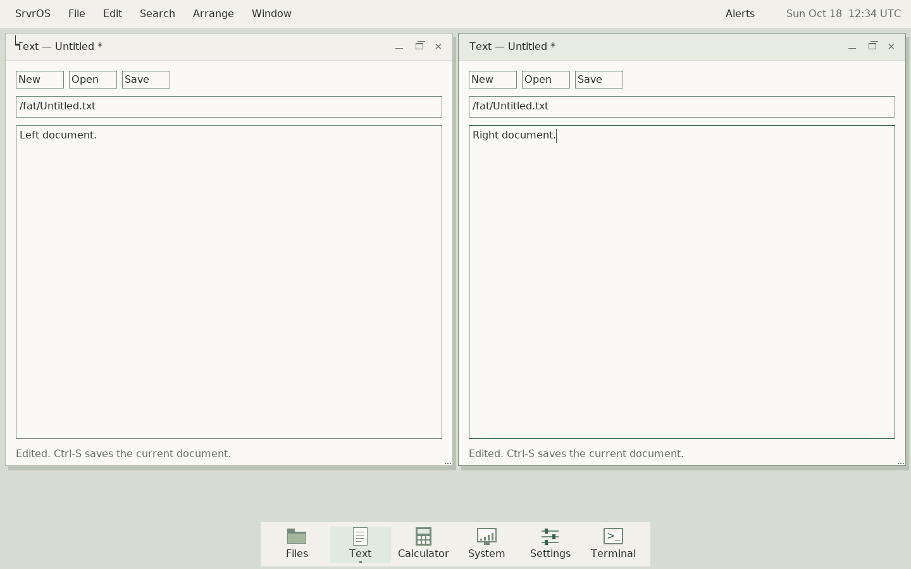

# Native desktop guide

This is the current `deskd` desktop, implemented with the shared native widget
library. The older `gui`/`displayd` applications and the browser design study are
historical prototypes. Start the current desktop from the SrvrOS monitor:

```text
run /fat/bin/deskd
```

Development evidence is from disposable QEMU VMs. The accepted MacBook Air
input/I/O checkpoint is preserved independently; the expanded app set has not
replaced it. See the [development journal](desktop-progress-2026-10-18.md) for
implementation and verification details.



## Desktop controls

The top bar contains the SrvrOS menu, the focused application's menus, Arrange,
Window, and the clock. The dock opens or focuses common apps. Command means the
Mac keyboard's Command key, or the Meta/Windows key in a VM.

| Action | Shortcut or control |
| --- | --- |
| Find an app or existing window | Command-Space; type a name and press Enter |
| Search file names | Command-Shift-F |
| Cycle windows | Alt-Tab / Alt-Shift-Tab |
| Navigate menus | F10, arrows, Enter, Escape |
| Tile left / right | Command-Alt-Left / Right |
| Center at the original normal size | Command-Alt-Up |
| Zoom / restore original geometry | Command-Alt-Down |
| Save a screenshot | Command-Shift-3 |
| Open Alerts | Command-Shift-N |
| Open contextual Help | F1 |
| Contextual actions | Right-click, Control-click, or Shift-F10 in supported controls |
| Close the active app | Command-W; apps guard unsaved work |
| Return to the monitor | SrvrOS → Return to console |

The launcher lists open windows as well as app launch entries. Select an existing
window to resume it; choose the app entry to open another instance. Eight client
windows can be open at once. A full desktop asks you to close a window before
opening another app. The [eight-window menu](assets/screenshots/native-desktop-window-menu.png)
shows the desktop at its current client limit.

Tile left/right retain the original frame across side switches. Center returns
to the original normal dimensions at the middle of the workspace. Restore size
returns to the original position as well. Tiled windows must be restored or
centered before free dragging/resizing. Narrow screens disable tiling when two
minimum-size clients would not fit.

The clock opens a month calendar with Today and keyboard navigation. Alerts
retain the current session's notifications. Timer and screenshot banners do not
steal keyboard focus. Screenshots include the pointer and are saved as verified
BMP files under `/fat/home/Screenshots`; the completion banner opens that folder.

## Applications

| Application | Current useful workflows |
| --- | --- |
| Files | Places and location browsing; Back/Forward; sortable details; create folders; open, rename, duplicate, inspect, or permanently delete selected items |
| Text | Open/edit/save UTF-8 text; selection and clipboard; Find/Replace and Replace All; multi-step undo/redo; draggable horizontal and vertical scrollbars |
| Terminal | A real PTY-backed shell; scrollback, selection/copy, foreground signals, resize, and independent sessions |
| Preview | Open PNG/JPEG/BMP; fit, zoom and pan; open the image in Sketch |
| Sketch | Pen, Line and Box tools; brush size and RGB color panel; undo/redo; import images and save verified BMP copies |
| Find Files | Background name search under a folder; kind filters; sortable results; open, reveal in Files, and copy paths |
| Calculator | Expressions, parentheses, keypad, explicit errors, copied results and calculation history |
| System | Live process and memory information; network interface, address, link state, speed and duplex; open diagnostics |
| Network Utility | Background Ping and DNS lookup; Stop; copied reports |
| Settings | Persisted desktop color, document text size and clock display/UTC offset |
| Clock | Countdown and stopwatch; pause/resume, laps and copied times; completion notification |
| Help | Offline topics, topic search, Back/Forward, keyboard navigation and copied pages |

App menus display the relevant shortcuts. Text uses Ctrl-O/S/F/H for Open, Save,
Find and Replace; Files uses Ctrl-L for location, Ctrl-F to search the current
folder and Ctrl-I for item information. Terminal reserves Control keys for the
foreground program: Ctrl-C interrupts it, Ctrl-Shift-C/V copy/paste, and
Shift-PageUp/PageDown scroll. A shell that exits leaves its terminal output
visible until the window closes.

## Documents and background work

Files and Text use a persistent worker with bounded nonblocking communication.
Save operates on a snapshot, verifies stored bytes, and leaves later edits dirty.
External file changes and name collisions produce explicit errors rather than
silently overwriting a conflicting file. Normal window close allows
Save/Discard/Cancel where appropriate. Normal desktop exit waits for accepted
background saves; Ctrl-Alt-Escape is an emergency exit, not a save operation.

Open/Save pickers and folder fields normalize absolute paths consistently:
repeated slashes and `.` collapse, and `..` stops at root. This is lexical path
normalization, not symbolic-link resolution. Operations target the mounted VFS;
the desktop does not yet offer a removable-volume manager or automatic mounting.

## Deliberate current limits

- Text documents and clipboard payloads are bounded to 64 KiB. Text keeps at
  most 256 undo records within its history arena. Editing is Unicode-codepoint
  based; shaping, grapheme clusters, IME and complete keyboard layouts are open.
- Files duplicates individual files up to 16 MiB. Directory deletion requires
  an empty directory; there is no recursive copy, Trash or undo for file deletion.
- File lists and search results retain at most 256 entries and report limits.
  Actionable paths are at most 159 bytes. Find Files searches names, with ASCII
  case folding; it is not content indexing or a symlink-aware search service.
- Preview accepts files up to 8 MiB, dimensions up to 4096 and four million
  pixels. EXIF orientation, color management and animated images are not yet
  implemented. Sketch is a small bitmap editor with four undo steps, not a
  layered graphics application.
- Terminal implements a bounded ANSI/VT subset. Resizing does not reflow saved
  lines; combining and double-width glyph semantics remain open.
- Notification history and calculator/stopwatch history belong to the session.
  Windows and unsaved documents are not restored after reboot.
- Network Utility uses the existing network stack. Live link reporting is
  implemented for e1000 in QEMU; no USB Ethernet adapter driver is implied.
- Laptop battery/brightness, safe suspend, audio, Wi-Fi and removable-device
  recovery need separate hardware work. Do not infer these from the VM desktop.
- Save verification is not power-loss atomicity. The generated test-image format
  also has existing external exFAT-conformance limits, recorded in the journal;
  the accepted hardware flash filesystem was not changed by this session.

## Developing and testing

Start with the [widget library guide](../userspace/widgets/README.md), which maps
shared controls, pure models, event routing and client-runtime services. Apps
should extend that library rather than copy a control implementation. The
[desktop architecture plan](desktop-plan-2026-10-17.md) describes the ownership
boundaries; the journal records their implementation in order.

```sh
tools/host-env.sh make -j2 all
make -j2 test-core test-desktop
tools/host-env.sh python3 tools/desktop_arrange_smoke.py --resolution 1440x900
tools/host-env.sh python3 tools/desktop_arrange_smoke.py --small
tools/host-env.sh python3 tools/desktop_lifecycle_soak.py --rounds 6
tools/host-env.sh python3 tools/desktop_capacity_smoke.py
tools/host-env.sh python3 tools/desktop_recovery_smoke.py
```

Each VM script copies the filesystem image before mutating it. Evidence lives
under `build/review/`; these commands neither reboot the laptop nor install a
hardware boot image. App-specific `tools/desktop_*_smoke.py` workflows exercise
saved file bytes, clipboard, controls and worker behavior beyond the lifecycle
checks. Read a script's options before using it as a targeted regression.

The next laptop-service work is grounded in a
[read-only battery/backlight inventory](macbook-air-laptop-services-2026-10-18.md),
including the observed ACPI SBS path and hardware acceptance order.
