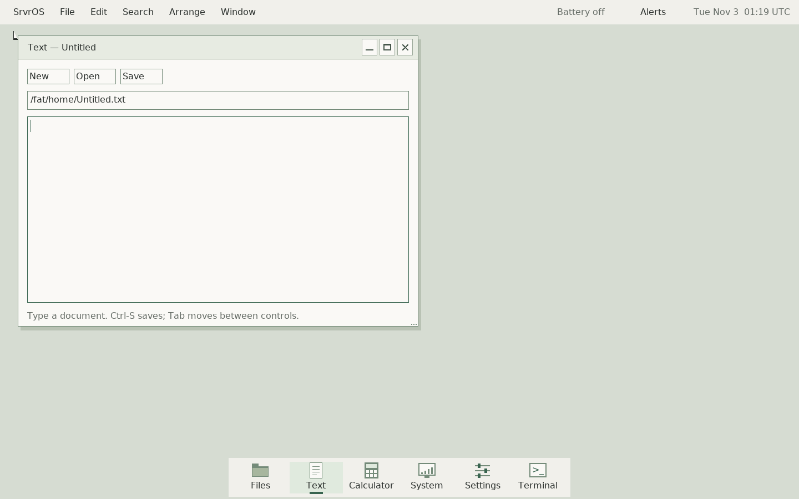
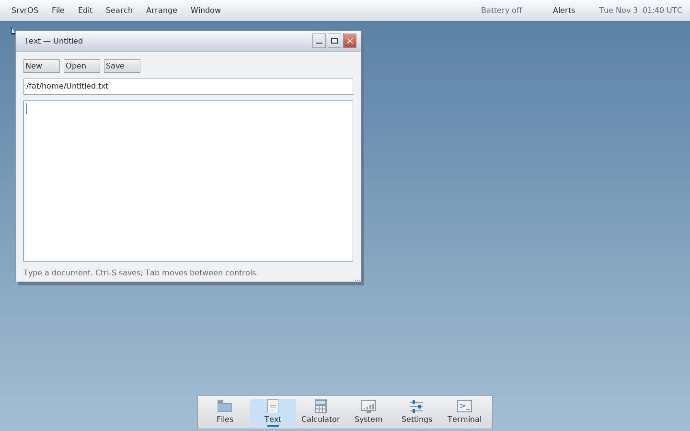
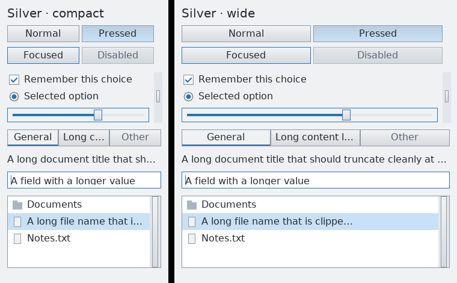

# Repository organization and Silver desktop

## Ownership

SrvrOS is the integration repository. It owns the kernel, drivers, shared ABI,
libc, renderer/fonts, compositor, desktop client runtime, services, shell tools,
image assembly and system-level tests. It pins complete known revision sets.

- **SrvrUI**, mounted at `userspace/widgets`: pure controls, models and themes.
  No allocation, filesystem work, OS calls or hidden event loops inside widgets.
- **SrvrApps**, mounted at `userspace/apps`: Clock, Find Files, Help, Network
  Utility, Sketch, Terminal, Preview and the standard tools (Files, Text,
  Settings, System and Calculator). Compositor/services and diagnostic clients
  stay with the OS. Executable names and image paths are unchanged.
- **SrvrPorts**, mounted at `ports`: third-party sources, adapters, staging
  recipes and port contracts. Its seven upstream gitlinks keep their exact
  previous pins; vendored byacc, SQLite, stb and uACPI stay vendored.

The UI and ports retain extracted path history. SrvrApps begins at the grouping
commit; its earlier history remains under `userspace/desk*` in SrvrOS at
`74d38d59869f9e6201c6cad6547461cd9fa8dac6`. No OS history was rewritten.
These repositories currently build against the matched OS SDK; they are not
standalone portable SDKs or independently bootable products.

## Clone, update and develop

```sh
git clone --recurse-submodules https://github.com/PaulMDemers/SrvrOS.git
cd SrvrOS
git submodule update --init --recursive
git submodule status --recursive
```

For this migration before it lands on main, clone with
`--branch overhaul/modular-desktop`. Existing checkouts crossing the extraction
commit may retain old tracked files or submodule metadata. Save any local work
first and prefer a fresh recursive checkout for migration. Do not delete dirty
module directories to suppress checkout warnings.

Submodules are deliberately pinned, usually checked out detached. For app work:

```sh
git -C userspace/apps switch -c app/my-change
# Edit, build and verify from the SrvrOS root.
git -C userspace/apps add <files>
git -C userspace/apps commit -m "Describe the application change"
git -C userspace/apps push -u origin app/my-change
git add userspace/apps
git commit -m "Update tested application revision"
```

Use the same sequence for UI or ports. Publish dependency commits before OS
pointers, and submit a reviewable OS change recording the exact tested revisions.
Normal updates use `git submodule update --init --recursive`, without `--remote`.
An application contributor should reuse SrvrUI controls and the OS runtime; a
port contributor should document actual supported APIs and missing dependencies
in its port contract. ABI changes require a coordinated OS/UI/apps/ports revision
set, rebuilt together. Do not infer native hardware acceptance from VM evidence.

Run one build or VM harness at a time per OS checkout. Hosted Actions remain
disabled per the coordination guide. Linux and Apple Silicon host instructions
remain in [development](development.md) and [macOS development](macos-development.md).

## Silver visual direction

The brief uses the dimensional controls and blue selection of Windows 7 with
the restrained silver surfaces of OS X 10.7–10.10. It is an original adaptation
to the native C renderer, with no copied platform assets, blur dependency or
external fonts. Theme Atlas guided the mapping; the user's explicit period
references take priority over catalog presets.

- Keep the menu bar, dock, window layout and task flows. Document content remains
  the primary work area; desktop chrome supplies hierarchy without new panels.
- Use silver surfaces, gentle vertical gradients, crisp bevels, dark neutral text,
  white editable/list content and blue focus/selection. Keep focused, pressed,
  disabled and selected states distinguishable. Active Close has a red treatment.
- Preserve existing 16/20 px type roles, control metrics, larger-type preference,
  hit targets and keyboard/capture behavior. No new motion or bitmap assets.
- Use the same gradient primitive in the toolkit and compositor. Work is bounded
  by damage clip and canvas; colors are anchored to full geometry so tiled
  repaint matches a full frame. Custom themes retain field/shadow fallbacks.
- `desk_theme_silver` is the named default; `desk_theme_quiet` remains a compatible
  symbol with the same values for existing callers. The default wallpaper is
  Blue; Sand and Slate remain available through Settings.

`make widget-theme-preview` renders actual controls in three 340 px accent columns,
including long text, focused editing and selected lists. It writes
`build/review/theme/silver.ppm`. This is a source-rendered specimen, not a mockup.
The initial Silver milestone used opaque chrome. The subsequent
[global appearance engine](desktop-theme.md) adds tinted composited glass. New icon artwork,
a font overhaul and broader application redesign are separate later decisions.

## Acceptance record

Current work and readiness are tracked in [the roadmap](roadmap.md). Local
evidence is retained under `build/review/modular-desktop/` and
`build/review/theme/`; build manifests include recursive source identities and
tracked/untracked dirty-source fingerprints. Image hashes remain authoritative
for the built payload. No native-device result is implied by host/QEMU checks.

## Verified Silver milestone — November 2, 2026

Runtime source `e65e5938` pins SrvrUI `4fdf91a`, SrvrApps `d386386` and
SrvrPorts `0494ae2`. All seven upstream pins and vendored port source hashes
match the original OS. All 35 app source files match apart from Settings'
Sage-to-Blue label; new repository docs and metadata are intentional.

Verification completed locally on Apple Silicon:

- Fresh recursive GitHub clone and clean full system build, followed by an
  incremental build of the final diagnostic-only correction: pass.
- Full `test-desktop test-desktop-io widget-theme-preview` with the documented
  Darwin compiler wrapper: pass (109 PASS records).
- New gradient/state/custom-theme/tiled clipping tests under native ARM64
  AddressSanitizer and UndefinedBehaviorSanitizer: pass.
- Six macOS/provenance tests, four ELF/Mach-O boundary tests, dependency checks,
  documentation links and whitespace checks: pass.
- Live application workflow at 1280×800: open/save, exact readback, replacement
  confirmation/cancel, unsaved cancel, clipboard/cut/undo, larger text, window
  controls, owned document routing and menu exit all pass.
- Compositor VM at 1280×800: input, scrolling, drag/resize, focus, close, idle,
  client death/replacement, abrupt server cleanup and console relaunch pass.
- Matching 1440×900 baseline and final desktop, 280/470 px control specimen,
  Settings, and unsaved dialog visually inspected. All test VMs stopped.

Fixed two visual regressions found during verification: the menu's content
interior must remain flat during scrolling, and image transparency checker colors
must retain their independent reference. Updated stale flat-button and
new-process test assumptions. Darwin fixture adaptations preserve date-grid,
syscall-signature and worker-lifecycle contracts; its file-service fixture checks
the requested stack but runs on a host-allocated stack. The final abrupt-exit
marker is synchronous only in the opt-in crash fixture, because queued worker
logging is destroyed by that intentional exit.

The complete Linux/core suite, native hardware and accessibility conformance
are not claimed. This is ready for OS integration review, not a new native-device
release. Source/image manifests and failed-attempt logs remain in local evidence.

Baseline and updated desktop (same 1440×900 empty-document state):





Real shared widget states at compact and wide sizes:



[Image provenance and hashes](assets/screenshots/silver-manifest.json).
