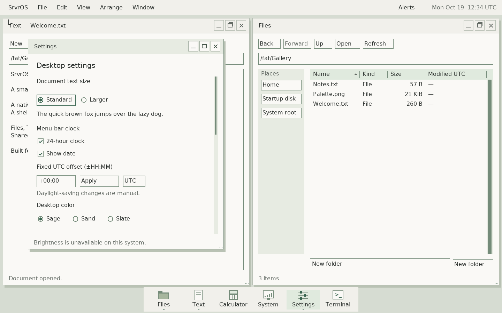
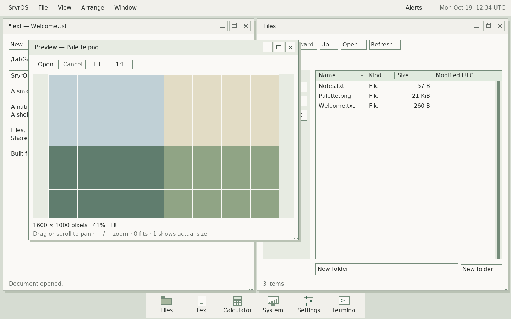

# Native desktop screenshots

These are captures of the real SrvrOS framebuffer, not mockups. The current
set was captured on 2026-10-19 from kernel/userspace source
`d9f5ce2e01ff74bf2f669a295735e78f770ae0b4` in QEMU q35 with 512 MiB RAM,
1440×900 output and 1× desktop scale. The VM used disposable exFAT storage and
no network. The displayed clock has a fixed fixture base, not the capture time.

## Text and Files

Two independently running apps arranged side by side using shared window
controls. The documents were created specifically for this gallery.


## Shared settings and controls

Settings uses the same native toolkit as the other applications. Brightness
correctly reports unavailable on this VM; this image does not demonstrate the
MacBook's brightness driver.



## Image preview

Preview loads a 1600×1000 generated color-grid PNG and fits it in the window.
The image is a deterministic test fixture with no external artwork.



## Reproduce and update

From a built checkout, with QEMU, xorriso and Pillow available:

```sh
make -j2 all
python3 tools/desktop_gallery.py
```

Prefix commands with `tools/host-env.sh` when using the optional local host tools.
The harness writes PNGs, original PPMs, serial/QEMU logs and a manifest to
`build/review/desktop-gallery/`. It waits for application operations, checks the
framebuffer dimensions, verifies lossless PPM-to-PNG conversion and requires a
clean desktop exit without recorded exceptions or client timeouts. It never
changes the physical boot entry or accesses a host block device.

Inspect each screenshot before copying the selected PNGs and manifest into
`docs/assets/screenshots/current/`. Update this page's source/date with them,
then run `make check-docs`. Do not retouch, reconstruct or crop a screenshot in
this current evidence set. Keep raw logs/PPMs under ignored `build/` storage.

The committed [manifest](assets/screenshots/current/manifest.json) records source,
artifact hashes, image hashes/dimensions, QEMU version and capture conditions.
Fresh captures need not be byte-identical: clock and rendering timing can vary.
The gallery proves the displayed VM workflows only. Physical support is tracked
separately in the [machine records](machines/README.md). Older images elsewhere
in `assets/screenshots/` belong to their original dated development checkpoints.
